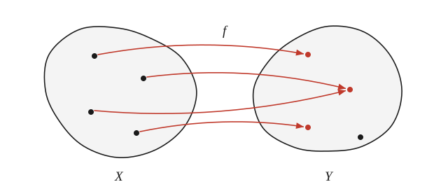
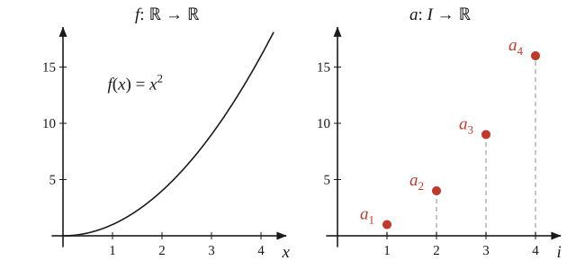
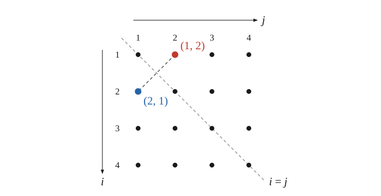
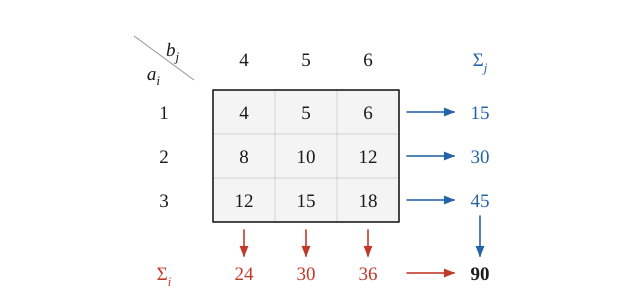
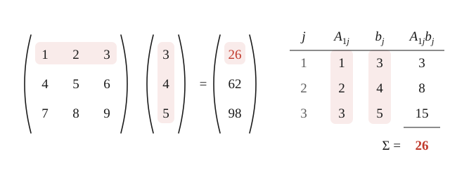
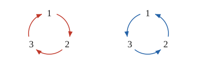

# Лекция 1. Индексы

> **Необходимые знания:** множество, отображение, декартово произведение множеств, числовая функция, последовательность, матрица и умножение матриц.
>
> **О чем лекция:** индексные функции (одного и нескольких индексов) как функции на конечном множестве; способы их задания, равенство и операции над ними. Суммы, свободные индексы и индексы суммирования, перестановочность сумм. Матричное умножение на языке индексов. Символы Кронекера и Леви-Чивиты.

> **Идея.** Лекция вводная: она посвящена не тензорам, а индексам; цель — научиться уверенно работать с выражениями вида $a_i$, $b_{ij}$, $\sum_k a_{ik}b_{kj}$, $\delta_{ij}$, $\varepsilon_{ijk}$, понимая каждое из них как функцию на конечном множестве. *(00:06:47–00:07:40)*

Эта лекция вводная: ни линейной алгебры, ни тензоров в ней ещё нет, и речь пойдёт об индексах. Тензоры одного типа образуют линейное пространство; в нём можно выбрать базис, и в базисе тензор описывается своими компонентами — набором чисел, занумерованных индексами. Работа с компонентами постоянно приводит к выражениям вида

$$
a_i, \qquad b_{ij}, \qquad \sum_{k=1}^{n} a_{ik} b_{kj}, \qquad \delta_{ij}, \qquad \varepsilon_{ijk}
$$

и к суммированиям по индексам. Цель лекции — научиться уверенно обращаться с такими выражениями, понимая каждое из них как функцию на некотором конечном множестве.

> **Идея.** Этот материал принято считать очевидным, и подробно его не разбирают; между тем без чёткого понимания того, какие записи с индексами осмысленны, дальнейшее изложение невозможно, — поэтому индексам отведена отдельная лекция. *(00:07:40–00:08:10)*

Материал этот обычно считается очевидным и потому подробно не разбирается. Однако без чёткого понимания того, какие записи с индексами осмысленны, а какие нет, последующее изложение линейной алгебры и тензоров невозможно. Поэтому индексам отведена отдельная лекция.

> **Идея.** Главная мысль лекции: всё, что известно о функциях на $\mathbb{R}$, более или менее дословно переносится на функции на конечном множестве, и там всё проще; непривычно лишь то, что аналогом интеграла служит сумма. *(00:20:30–00:20:55)*

Главная мысль лекции состоит в том, что почти всё, что известно о привычных функциях на $\mathbb{R}$, более или менее дословно переносится на функции, заданные на конечном множестве, и в этом случае всё только проще. Непривычным окажется лишь то, что аналогом интеграла служит сумма. Поэтому на каждом шаге новое будет сопоставляться с уже известным для функций на $\mathbb{R}$.

## 1. Функции и отображения

> **Идея.** Отображение сопоставляет каждому элементу $X$ единственный элемент $Y$, и единственность здесь существенна. *(00:08:30–00:09:20, 00:15:29)*

Напомним понятие отображения, частным случаем которого является функция. Пусть $X$ и $Y$ — два множества. **Отображением** $f\colon X \to Y$ называется правило, которое каждому элементу $x \in X$ сопоставляет единственный элемент $f(x) \in Y$. Единственность существенна: элемент $X$ не может переходить сразу в два разных элемента $Y$ (рис. 1).

*Рис. 1. Отображение $f\colon X \to Y$: из каждой точки $X$ выходит ровно одна стрелка. При этом две стрелки могут прийти в одну точку $Y$, а некоторые точки $Y$ могут остаться без стрелок: этого определение не запрещает.*

> **Идея.** Функции, операторы, функционалы — всё это отображения, различающиеся лишь множествами; числовая функция — отображение числового множества в числовое. *(00:08:43–00:09:14)*

Функции, операторы, функционалы — всё это отображения; различные названия указывают лишь на то, между какими множествами отображение действует. **Числовой функцией**, или просто функцией, называют отображение одного числового множества в другое, например $f\colon \mathbb{R} \to \mathbb{R}$. Запись

$$
f\colon \mathbb{R} \to \mathbb{R}, \qquad f(x) = x^2
$$

означает, что каждому действительному числу сопоставлен его квадрат.

> **Идея.** Имя функции — $f$, а буква $x$ лишь обозначает аргумент; поэтому $f(x) = x^2$ и $f(y) = y^2$ — одна функция, а $f(x) = y^2$ — бессмыслица. *(00:09:20–00:10:00, 00:16:40–00:17:00)*

Следует чётко понимать, что имя функции — $f$. Буква $x$ — лишь обозначение аргумента, и к самой функции она никакого отношения не имеет. Записи

$$
f(x) = x^2 \qquad \text{и} \qquad f(y) = y^2
$$

описывают одну и ту же функцию $f$: правило «возвести в квадрат то, что подано на вход» не зависит от того, как обозначен вход. Запись же $f(x) = y^2$ — бессмыслица. По той же причине пишут $f\colon \mathbb{R} \to \mathbb{R}$, указывая имя функции, но не $f(x)\colon \mathbb{R} \to \mathbb{R}$.

> **Идея.** Физика приучает к противоположному: одну величину обозначают одной буквой, даже когда это разные функции ($p(T, V)$ и $p(T, S)$); этим удобством злоупотреблять не следует. *(00:10:00–00:11:00)*

Это действительно важно, хотя бы потому, что физика приучает к противоположному. В физике одну и ту же величину часто обозначают одной буквой, даже когда с математической точки зрения речь идёт о разных функциях: давление $p(T, V)$ как функцию температуры и объёма и давление $p(T, S)$ как функцию температуры и энтропии. Физически это одно и то же давление, математически — две разные функции, и обозначаться они должны разными буквами. Этим удобством мы злоупотреблять не будем.

> **Идея.** Функцию задают формулой, графиком или таблицей; таблица пригодна лишь при конечном числе значений аргумента, но тогда она лучший способ — и именно таким функциям посвящена лекция. *(00:11:00–00:11:45)*

Функцию можно задать формулой, графиком или таблицей значений. Таблица пригодна только тогда, когда аргумент принимает конечное число значений, — бесконечную таблицу выписать нельзя; зато в этом случае она оказывается наилучшим способом. Именно таким функциям и посвящена эта лекция.

## 2. Индексные функции

> **Идея.** Индексная функция — отображение конечного множества $I = \{1, \dots, n\}$ в $\mathbb{R}$: дискретна лишь область определения, значения — обычные действительные числа. *(00:12:00–00:14:30, 00:28:00)*

Функции на всём множестве действительных чисел устроены сложнее, чем функции, о которых пойдёт речь дальше. Зафиксируем натуральное $n \in \mathbb{N}$ и рассмотрим множество первых $n$ натуральных чисел

$$
I = \{1, 2, 3, \dots, n\}.
$$

**Индексной функцией** называется любое отображение $a\colon I \to \mathbb{R}$. Подчеркнём, что значения такой функции — обычные действительные числа; дискретна лишь её область определения.

> **Идея.** Для индексных функций принята запись $a_i \equiv a(i)$; $a$ — имя функции, $i$ — имя аргумента, и всё сказанное об именах сохраняется. *(00:14:00–00:14:20)*

По чисто визуальным причинам для индексных функций принята особая запись: вместо $a(i)$ пишут $a_i$. По определению

$$
a_i \equiv a(i), \qquad i \in I.
$$

Здесь $a$ — имя функции, $i$ — имя её аргумента, а $a_i$ — значение функции $a$ на элементе $i$. Всё сказанное выше об именах функций и аргументов остаётся в силе.

> **Идея.** Индексную функцию естественнее всего задавать таблицей: график вырождается в $n$ точек и ничего не добавляет, а формула хотя и существует всегда (интерполяционный многочлен), но строить её незачем, когда значения можно просто перечислить. *(00:12:30–00:14:30; уточнено в лекции 2, 00:03:32–00:03:57)*

Как задать индексную функцию? Её график вырождается в $n$ отдельных точек (рис. 2) и ничего не добавляет. Можно задать её формулой, например $a_i = i^2$. Для функции на $\mathbb{R}$ подобрать формулу бывает непросто — например, если кривая нарисована от руки или получена в эксперименте и имеет излом. Для функции на конечном множестве формула существует всегда: можно подобрать многочлен, принимающий в $n$ заданных точках заданные значения. Однако строить его незачем: самый естественный способ — просто перечислить значения функции во всех $n$ точках, т. е. составить таблицу.

> **Вопрос 9.** (лекция 2, 00:03:32–00:03:57) В начале лекции 2 сказано, что в лекции 1 было неточно: для функции на конечном множестве формулу подобрать можно всегда (многочлен с заданными значениями в заданных точках), просто это незачем. Абзац выше и фраза в § 4.1 исправлены соответственно; в записи лекции 1 было «формула находится редко». Верно ли так, или поправку лучше вынести в отдельное замечание?

*Рис. 2. Слева — график функции $f\colon \mathbb{R} \to \mathbb{R}$, $f(x) = x^2$: непрерывная кривая. Справа — график индексной функции $a\colon I \to \mathbb{R}$, $a_i = i^2$, при $n = 4$: всего четыре точки.*

> **Идея.** Пример: таблица значений $a_i = i + 1$ на $\{1, 2, 3, 4\}$ задаёт функцию полностью, и информации в ней очень мало по сравнению с функцией на $\mathbb{R}$. *(00:37:47–00:38:20)*

Пусть, например, $I = \{1, 2, 3, 4\}$ и $a_i = i + 1$. Таблица

| $i$ | $a_i$ |
|---|---|
| $1$ | $2$ |
| $2$ | $3$ |
| $3$ | $4$ |
| $4$ | $5$ |

задаёт эту функцию полностью. Информации в ней очень мало: чтобы полностью задать функцию $\mathbb{R} \to \mathbb{R}$, потребовалось бы несравнимо больше.

> **Идея.** Последовательность — та же индексная функция, но на бесконечном множестве $\mathbb{N}$; и для неё имя аргумента несущественно: $a_i$ и $a_j$ — одна последовательность. *(00:21:00–00:23:30)*

Близкий объект — последовательность. В математическом анализе последовательность $(a_i)$ по определению есть отображение $a\colon \mathbb{N} \to \mathbb{R}$ с той же записью $a_i \equiv a(i)$, т. е. та же индексная функция, но определённая на бесконечном множестве. И здесь последовательность — это функция $a$, а $i$ лишь пробегает значения $1, 2, 3, \dots$: если одну и ту же последовательность в одном месте записали как $a_i$, а в другом как $a_j$, то ничего не изменилось.

> **Идея.** Полезно переформулировать знакомые понятия на языке множеств и отображений; например, уравнение — это отображение множества, на котором ищется решение, в множество $\{\text{да}, \text{нет}\}$. *(00:21:30–00:24:30)*

> *Замечание.* Полезно переформулировать знакомые понятия на строгом языке множеств и отображений. Например, уравнение, скажем $2 - x = 3$, можно понимать как отображение множества, среди элементов которого ищется решение, в множество из двух элементов $\{\text{да}, \text{нет}\}$: подставленное число либо удовлетворяет равенству, либо нет. Для алгебраического уравнения это множество чисел, для дифференциального — множество функций, и выбор множества — часть постановки задачи: уравнение $2 - x = 3$ не имеет решений среди натуральных чисел, но имеет решение среди целых. Сама по себе такая переформулировка ничего нового не даёт, но строгий язык помогает навести порядок в понятиях.

> **Вопрос 1.** Как оформлять замечания и предупреждения? В обзоре: не рамкой, а «как подпись к рисунку» — мельче или светлее; рассчитывать на бумагу. Сейчас стоит вариант A (мельче и серым, с небольшим отступом). Четыре варианта на одной странице — в листе `aside-options.pdf` (пакет ответа на обзор): A — как подпись; B — отступ и метка капителью; C — тонкая линия слева; D — заметка на полях. Какой выбрать? Там же — варианты для «Доказательства» и «Предупреждения» (жирным или нет).

## 3. Равенство и операции

> **Вопрос 2.** В обзоре (06:43–07:51) раздел попросили сделать в двух версиях. Здесь — версия А: изложение, без вопросов к читателю. Версия Б — те же примеры в форме «вопрос — ответ», но книжным языком — в пакете ответа на обзор (`section-3-qa.pdf`). Какую оставить? После выбора один и тот же тон будет выдержан во всей книге.

> **Идея.** В каждом равенстве с индексами следует понимать, что приравнивается — сами функции или их значения; это разные утверждения. *(00:15:30–00:19:30)*

Поскольку в записи $a_i$ буква $a$ — имя функции, а $i$ — имя аргумента, в каждом равенстве следует понимать, что именно приравнивается: сами функции или их значения. Это разные утверждения, и записываются они по-разному. Разберём их на примере. Пусть $I = \{1, 2, 3, \dots, n\}$ и

$$
a_i = i, \qquad b_j = j.
$$

Записать вторую функцию как $b_j = j$ или как $b_i = i$ — безразлично: это одна и та же функция $b$, так же как $f(x) = x^2$ и $f(y) = y^2$ — одна функция.

> **Идея.** Равенство функций $a = b$ означает, что это одна функция под двумя именами. *(00:17:00–00:18:00, 00:19:24)*

Функции $a$ и $b$ сопоставляют каждому элементу $I$ одно и то же число — сам этот элемент. Следовательно, это одна и та же функция, названная двумя именами, и можно записать равенство функций

$$
a = b.
$$

Её непрерывный аналог — функция $f(x) = x$, возвращающая свой аргумент без изменений.

> **Идея.** Равенство значений $a_i = b_i$ осмысленно лишь с указанием множества, которому принадлежит $i$, потому что значения функций могут совпадать не везде. *(00:19:00–00:20:45)*

Равенство $a_i = b_i$ — утверждение другого рода: приравниваются уже не функции, а их значения при некотором $i$. В такой записи подразумевается, что $i$ пробегает какое-то множество, и его следует указывать явно:

$$
a_i = b_i, \qquad i \in I.
$$

Указание множества существенно, поскольку значения функций могут совпадать не везде. Для $f(x) = x$ и $g(x) = |x|$ равенство $f(x) = g(x)$ выполняется при $x \geqslant 0$, но не при всех $x$; точно так же равенство значений индексных функций может выполняться при одних $i$ и не выполняться при других. Для функций $a$ и $b$ из примера оно выполняется при всех $i \in I$ и равносильно равенству функций $a = b$.

> **Идея.** Запись $a_i = b_j$ бессмысленна, как и $f(x) = y^2$: связь между аргументами не указана. *(00:18:00–00:18:30)*

Запись же $a_i = b_j$ — бессмыслица: слева значение функции $a$ при одном аргументе, справа значение функции $b$ при другом, и никакой связи между ними не указано. Это бессмыслица того же рода, что и $f(x) = y^2$.

> **Идея.** Запись $b = a + 1$ корректна, только если $1$ понимать как функцию, всюду равную единице: складывать функцию с числом нельзя. *(00:24:30–00:27:30)*

Та же тонкость возникает при записи операций. Пусть $a_i = i$ и $b_i = i + 1$, $i \in I$. Запись

$$
b_i = a_i + 1, \qquad i \in I,
$$

корректна: это равенство значений, в полной аналогии с $g(x) = f(x) + 1$ для $f(x) = x$ и $g(x) = x + 1$. Запись же

$$
b = a + 1
$$

корректна лишь при определённом понимании: складывать функцию с числом нельзя, это объекты разной природы. Единицу здесь следует понимать как функцию $1\colon I \to \mathbb{R}$, всюду равную единице:

$$
1_i \equiv 1(i) = 1 \in \mathbb{R}, \qquad i \in I.
$$

Слева в этой записи $1$ — имя функции, справа — число.

> **Идея.** Арифметические операции над индексными функциями определяются поточечно, как над обычными функциями. *(00:14:30–00:15:30, 00:27:30–00:28:00)*

Арифметические операции над индексными функциями определяются так же, как над обычными функциями, — поточечно. Если $a, b\colon I \to \mathbb{R}$, то

$$
c_i = a_i b_i, \qquad i \in I,
$$

задаёт новую функцию $c\colon I \to \mathbb{R}$ — в полной аналогии с $h(x) = f(x)\, g(x)$. Точно так же функции можно складывать, вычитать, делить (там, где знаменатель не обращается в нуль) и возводить одну в степень другой.

> **Идея.** Композиция для индексных функций почти не встречается и не понадобится: в компонентах тензоров все операции линейны, и сложнее сумм произведений ничего не возникнет. *(00:28:00–00:28:45)*

Композиция, т. е. подстановка одной функции в другую, как в $g(f(x))$, для индексных функций почти не встречается: записывать её в индексных обозначениях неудобно, и она не понадобится. Индексные функции нужны для записи компонент тензоров в базисе, а все операции там линейны, так что ничего сложнее сумм произведений не возникнет.

## 4. Функции нескольких индексов

> **Идея.** Из $f(x)$ и $g(y)$ строится функция двух переменных $h(x, y) = f(x)\, g(y)$ на $\mathbb{R}^2$ — множестве упорядоченных пар, где порядок элементов пары существен. *(00:29:30–00:32:50)*

Для функций на $\mathbb{R}$ наряду с $h(x) = f(x)\, g(x)$ возможна и конструкция

$$
h(x, y) = f(x)\, g(y).
$$

Она задаёт функцию двух переменных $h\colon \mathbb{R}^2 \to \mathbb{R}$, где $\mathbb{R}^2 \equiv \mathbb{R} \times \mathbb{R}$ — декартово произведение, т. е. множество всех упорядоченных пар $(x, y)$ действительных чисел. Слово «упорядоченных» означает, что важно, какой элемент пары стоит на каком месте: $(0, 1)$ и $(1, 0)$ — разные пары, и значение $h(0, 1)$ вовсе не обязано совпадать с $h(1, 0)$.

> **Идея.** Изображение $\mathbb{R}^2$ плоскостью — лишь удобная визуализация; никакой дополнительной структуры (расстояний, углов) не предполагается: $\mathbb{R}^2$ — просто множество упорядоченных пар. *(00:30:41–00:33:30)*

Множество $\mathbb{R}$ принято изображать прямой, $\mathbb{R}^2$ — плоскостью, $\mathbb{R}^3$ — пространством: точка плоскости как раз задаётся парой чисел. При таком изображении различие пар $(x, y)$ и $(y, x)$ видно наглядно: соответствующие точки переходят друг в друга при отражении относительно биссектрисы координатного угла. Однако это лишь способ изображения. Часто под $\mathbb{R}^2$ понимают плоскость с расстояниями и углами, но здесь никакая дополнительная структура не нужна и не вводится: $\mathbb{R}^2$ — просто множество упорядоченных пар.

> **Идея.** Точно так же $c_{ij} = a_i b_j$ задаёт функцию на $I^2$ — множестве из $n^2$ упорядоченных пар индексов. *(00:30:40–00:31:30)*

То же самое можно проделать с индексными функциями. Если $a, b\colon I \to \mathbb{R}$, то

$$
c_{ij} = a_i b_j
$$

задаёт функцию $c\colon I^2 \to \mathbb{R}$, где $I^2 \equiv I \times I$ — множество упорядоченных пар $(i, j)$ с $i, j \in I$. В отличие от $\mathbb{R}^2$, в $I^2$ всего $n^2$ элементов.

> **Идея.** Элементы $I^2$, как и $\mathbb{R}^2$, можно изобразить — точками сетки; это лишь визуализация: пары $(1, 2)$ и $(2, 1)$ различны по определению, а не потому, что так нарисовано. *(00:33:16–00:33:30 — изображение $\mathbb{R}^2$; сетка для $I^2$ — добавление редактора)*

Как и $\mathbb{R}^2$, множество $I^2$ удобно изобразить: каждую пару $(i, j)$ можно представить точкой на пересечении $i$-й строки и $j$-го столбца сетки (рис. 3). Это не более чем визуализация. То, что $(1, 2)$ и $(2, 1)$ — разные элементы $I^2$, следует из определения упорядоченной пары; на рисунке это лишь хорошо видно. Никакого взаимного расположения у самих элементов $I^2$ нет.

*Рис. 3. Одна из возможных визуализаций множества $I^2$ при $n = 4$: каждая из шестнадцати упорядоченных пар $(i, j)$ изображена точкой в $i$-й строке и $j$-м столбце. При таком изображении пары $(1, 2)$ и $(2, 1)$ переходят друг в друга при отражении относительно диагонали $i = j$. Функция $c\colon I^2 \to \mathbb{R}$ сопоставляет число каждой паре, т. е. каждой точке рисунка.*

> **Вопрос 3.** Нужен ли рис. 3? В обзоре (08:56) он показался лишним. Сетки нет ни в записи, ни в заметках — это добавление; оно опирается на изображение $\mathbb{R}^2$ плоскостью (00:33:16). Теперь он подан как одна из возможных визуализаций. На него ссылаются § 4.3 (симметрия) и § 7.2 (диагональ символа Кронекера). Варианты: а) оставить в этой подаче; б) убрать и говорить только о двумерной таблице значений.

> **Идея.** Функции можно рассматривать на $I^k$ при любом $k$; значения записывают индексами снизу, и такие функции тоже называют индексными — функциями $k$ индексов. *(00:33:45–00:34:30)*

Ничто не мешает рассматривать функции и большего числа аргументов:

$$
T\colon I^3 \to \mathbb{R}, \qquad \dots, \qquad d\colon I^{10} \to \mathbb{R},
$$

где $I^k \equiv I \times I \times \dots \times I$ ($k$ раз) — множество упорядоченных наборов из $k$ элементов $I$. Такие функции также называют индексными; когда важно число аргументов, говорят о функции $k$ индексов. Значения записывают, как и в случае одного индекса, индексами снизу:

$$
c_{ij} \equiv c(i, j), \qquad T_{ijk} \equiv T(i, j, k),
$$

и всё сказанное об именах функций и аргументов сохраняется без изменений.

> **Вопрос 4.** Определение. В обзоре: «многоиндексная функция» — лишнее отдельное определение, её надо называть тоже индексной (00:01, 10:12–11:07). Сейчас сделано так: в § 2 индексная функция определена на $I$, а здесь то же название распространено на функции на $I^k$, без нового термина. Варианты: а) оставить так; б) сразу в § 2 определить индексную функцию как любое отображение $a\colon I^k \to \mathbb{R}$, $k \geqslant 1$ («функция $k$ индексов»); тогда декартово произведение понадобится уже в § 2; в) другое определение — например, как функции на произвольном конечном множестве.

> **Идея.** Функции нескольких индексов — ещё не тензоры: выражение вроде $a_{ij}$ — это компоненты тензора в базисе, а не сам тензор. *(00:33:30–00:34:10)*

> *Предупреждение.* Функции нескольких индексов — это ещё не тензоры. Выражение вроде $a_{ij}$ может быть компонентами тензора в некотором базисе, но не самим тензором. Тензор — объект, существующий независимо от базиса, а в разных базисах у него разные компоненты, примерно как у вектора. Подробно об этом пойдёт речь в дальнейших лекциях.

### 4.1. Таблицы значений

> **Идея.** Функция нескольких индексов задаётся таблицей значений или формулой; чтобы получить таблицу из формулы, надо вычислить все значения. *(00:38:20–00:39:30)*

Функция нескольких индексов, как и функция одного индекса, задаётся таблицей значений или формулой. Возьмём $I = \{1, 2, 3\}$ и функцию $T\colon I^2 \to \mathbb{R}$, заданную формулой

$$
T_{ij} = i^2 + 2ij.
$$

Формула здесь выбрана произвольно: функции, встречающиеся на практике, обычно не задаются формулой естественным образом. Чтобы составить таблицу, нужно вычислить значения при всех аргументах; например, $T_{11} = 1^2 + 2 \cdot 1 \cdot 1 = 3$ и $T_{23} = 2^2 + 2 \cdot 2 \cdot 3 = 16$. Таблицу можно составить двумя способами:

$$
\begin{array}{cc|c}
i & j & T_{ij} \\ \hline
1 & 1 & 3 \\
1 & 2 & 5 \\
1 & 3 & 7 \\
2 & 1 & 8 \\
2 & 2 & 12 \\
2 & 3 & 16 \\
3 & 1 & 15 \\
3 & 2 & 21 \\
3 & 3 & 27
\end{array}
\qquad \longleftrightarrow \qquad
\begin{array}{c|ccc}
 & j=1 & j=2 & j=3 \\ \hline
i=1 & 3 & 5 & 7 \\
i=2 & 8 & 12 & 16 \\
i=3 & 15 & 21 & 27
\end{array}
$$

> **Идея.** Обе таблицы несут одну и ту же информацию; двумерная таблица привычна для двух индексов, а таблица-список, где каждая строка — элемент $I^2$ со значением, показывает функцию как отображение и годится для любого числа индексов. *(00:40:10–00:41:10, 00:47:00–00:47:30)*

В обеих таблицах девять значений, и информации в них одинаково. Двумерная таблица (справа) привычна и удобна, когда индексов два. Таблица-список (слева) удобна другим: каждая её строка — один элемент множества $I^2$, т. е. пара $(i, j)$, вместе со значением функции на нём. Она прямо показывает, как устроена функция нескольких индексов — как отображение, — и одинаково пригодна для любого числа индексов: для функции на $I^3$ получится просто более длинный список. Именно так и полезно представлять себе такие функции.

> **Вопрос 5.** Термин. «Квадратная таблица» в обзоре отвергнута (13:53); сейчас вместо неё — «двумерная таблица». Варианты: а) «двумерная таблица»; б) «"многомерная" таблица» в кавычках (предложено в обзоре); в) другой.

> **Идея.** Представление тензора «трёхмерной таблицей» неудачно: такую таблицу трудно себе представить, и понимания она не даёт, а набор чисел — это компоненты, а не тензор. *(00:40:53, 00:41:23)*

> *Замечание.* Иногда встречается объяснение «вектор — это столбец, матрица — таблица, тензор — трёхмерная таблица», но оно неудачно: трёхмерную таблицу построить можно, однако представить её себе трудно, и понимания она не даёт; кроме того, как отмечено выше, набор чисел — это компоненты тензора, а не сам тензор.

### 4.2. Перенумерация пар

> **Идея.** У функций нескольких индексов есть возможность, которой нет у функций на $\mathbb{R}$: конечное множество $I^2$ можно занумеровать одним индексом, и функцию двух индексов можно записать как функцию одного индекса. *(00:34:30–00:35:55)*

У функций нескольких индексов есть возможность, которой нет у функций на $\mathbb{R}$. Множество $I^2$ конечно: в нём ровно $n^2$ элементов, и их можно занумеровать одним индексом $k$ по какому-нибудь правилу — каким именно, не важно. Множества $I$ для этого не хватит, поэтому $k$ пробегает новое множество $\{1, 2, \dots, n^2\}$. Тогда функцию двух индексов можно записать как функцию одного индекса:

$$
c_{ij} = d_k, \qquad (i, j) \in I^2, \qquad k \in \{1, 2, \dots, n^2\},
$$

где $k$ — номер пары $(i, j)$. Такая запись выглядит непривычно, но она корректна, если правильно понимать, чему принадлежит $k$. Номер строки в таблице-списке из § 4.1 — как раз такой индекс.

> **Идея.** С компонентами тензоров поступают наоборот: $n^2$ компонент можно было бы занумеровать одним индексом, но двумя удобнее; число индексов выбирают из соображений удобства. *(00:35:53–00:36:30)*

> *Забегая вперёд.* С компонентами тензоров происходит то же самое, только в обратную сторону. У тензора может быть, скажем, $n^2$ компонент, и занумеровать их одним индексом математика не запрещает; однако двумя индексами нумеровать их оказывается естественнее, и так и поступают. Сколько индексов использовать, решают из соображений удобства.

> **Идея.** Похожая, хотя и не та же ситуация есть в физике: $T(x, y)$ и $T(\vec r)$ — разные отображения разных множеств, названные одной буквой потому, что это одна физическая величина. *(00:36:29–00:37:13)*

> *Замечание.* Отдалённая аналогия есть и у функций на $\mathbb{R}$, и снова из физики. Распределение температуры на плоскости записывают и как $T(x, y)$, и как $T(\vec r)$, хотя первая функция принимает на вход пару чисел, а вторая — вектор, т. е. элемент векторного пространства, который вовсе не обязательно задан парой чисел. Это разные отображения разных множеств; одной буквой их обозначают лишь потому, что в одной и той же точке они принимают одно и то же значение — это одна физическая величина. С математической точки зрения такая запись некорректна, как и запись $p(T, V)$ и $p(T, S)$ из § 1.

### 4.3. Симметрия

> **Идея.** Функция двух индексов симметрична, если $a_{ij} = a_{ji}$ при всех $i, j$, — так же, как функция двух переменных бывает симметрична относительно перестановки аргументов. *(01:02:50–01:03:20)*

Функция двух переменных может обладать свойством $f(x, y) = f(y, x)$ — симметрией относительно перестановки аргументов. Точно так же функция $a\colon I^2 \to \mathbb{R}$ называется **симметричной**, если

$$
a_{ij} = a_{ji}, \qquad i, j \in I.
$$

> **Идея.** Если изобразить $I^2$ сеткой (рис. 3) или записать функцию двумерной таблицей, симметрия означает равенство значений в местах, симметричных относительно главной диагонали. *(01:03:12)*

Если воспользоваться изображением множества $I^2$ с рис. 3, симметрия означает, что в точках, симметричных относительно диагонали $i = j$, функция принимает одинаковые значения. Соответственно, если записать симметричную функцию двумерной таблицей, таблица окажется симметричной относительно своей главной диагонали.

## 5. Суммы

> **Идея.** Для функций на $\mathbb{R}$ есть операция интегрирования, результат которой — число; здесь важна сама операция, а не то, зачем её выполняют. *(00:47:30–00:48:30)*

Для функций на $\mathbb{R}$ определена операция интегрирования, и её результат — число:

$$
\int_{\mathbb{R}} f(x)\, dx = \alpha \in \mathbb{R}.
$$

Зачем вычислять тот или иной интеграл, определяется конкретной, например физической, задачей; в данном случае важна сама операция.

> **Идея.** Аналог интеграла для индексной функции — сумма её значений. *(00:48:30–00:50:00)*

Для индексных функций аналогом интеграла служит сумма. Пусть $a\colon I \to \mathbb{R}$. По определению

$$
\sum_{i=1}^{n} a_i \equiv a_1 + a_2 + \dots + a_n = \alpha \in \mathbb{R}.
$$

> **Идея.** Сумма значений индексной функции — число; в этом и состоит аналогия с определённым интегралом, и, как интеграл, сумму можно брать не только по всему множеству определения, но и по его части. *(00:48:12–00:48:30, 00:50:13–00:50:40)*

Сумма значений индексной функции — число, так же как определённый интеграл функции на $\mathbb{R}$ — число. В этом и состоит аналогия между двумя операциями: сумма по всем $i \in I$ — аналог интеграла по всей прямой. Аналогия идёт и дальше: интеграл можно брать по отрезку, а сумму — по части множества определения (по отрезку значений индекса, только по чётным $i$, по $i \neq j$ и т. д.), и результат по-прежнему будет числом. По какому множеству суммировать, определяется задачей.

> **Идея.** О записи суммы: промежуточные значения индекса не пишут, нижний предел указывают, так как суммирование не всегда начинается с единицы; различия между «определённой» и «неопределённой» суммой нет. *(00:48:46–00:49:40)*

Промежуточные значения индекса в записи суммы не указывают: подразумеваются все натуральные числа подряд от нижнего предела до верхнего. Нижний предел указывают потому, что суммирование не всегда начинается с единицы; ряд Тейлора, например, принято записывать начиная с нуля. Различия, подобного различию между определённым и неопределённым интегралом, здесь нет: сумма всегда берётся по какому-то множеству значений индекса.

> **Идея.** Сумма функции двух индексов по одному из них — функция оставшегося индекса: при каждом его значении получается своё число. *(00:51:00–00:52:00)*

Рассмотрим теперь функцию двух индексов $a\colon I^2 \to \mathbb{R}$ и выражение

$$
\sum_{i=1}^{n} a_{ij}.
$$

Прежде чем вычислять, чему оно равно, следует понять, что это за объект. При $j = 1$ получается число $a_{11} + a_{21} + \dots + a_{n1}$, при $j = 2$ — другое число, и т. д. Каждому $j \in I$ сопоставлено число, т. е. результат — отображение $I \to \mathbb{R}$, новая функция индекса $j$:

$$
\sum_{i=1}^{n} a_{ij} = b_j.
$$

> **Идея.** Это аналог интеграла функции двух переменных по одной из них: результат — функция оставшейся переменной. *(00:52:00–00:52:30)*

Это аналог интеграла по одной из переменных:

$$
\int_{\mathbb{R}} f(x, y)\, dx = g(y).
$$

При каждом фиксированном $y$ получается своё число, т. е. функция $g(y)$. Если интегрировать не по всей прямой, а по отрезку, получится другая функция, но объект той же природы — функция от $y$.

> **Идея.** Общий принцип: результат не зависит от индекса суммирования и зависит от свободных индексов; индекс суммирования можно переименовать произвольно. *(00:56:40–00:57:10, 01:11:00–01:11:30)*

Отсюда следует общий принцип: от индекса, по которому ведётся суммирование, результат не зависит — так же как интеграл не зависит от переменной интегрирования. Такой индекс называют **индексом суммирования** (или немым); остальные индексы, от которых результат зависит и которые в него входят, называют **свободными**. Индекс суммирования можно переименовать произвольно, и результат от этого не изменится:

$$
\sum_{i=1}^{n} a_{ij} = \sum_{k=1}^{n} a_{kj} = b_j.
$$

> **Идея.** Знакомая по физическим задачам ситуация: если предел интегрирования обозначен той же буквой, что и переменная интегрирования, переменную переобозначают; пределу интегрирования соответствует диапазон суммирования. *(00:55:50–00:56:40)*

> *Замечание.* С этим принципом связана знакомая по физическим задачам ситуация. Если верхний предел интеграла обозначен той же буквой, что и переменная интегрирования, переменную приходится переобозначать, например штрихом:
>
> $$\int_{\tau}^{t} \frac{dt'}{t'}.$$
>
> Результат зависит от верхнего предела $t$, но не может зависеть от переменной интегрирования, поэтому запись с одной и той же буквой $t$ и в пределе, и под интегралом была бы бессмыслицей. Пределу интегрирования соответствует диапазон суммирования, который в этой лекции почти всегда — всё множество $I$.

### 5.1. Повторяющиеся индексы

> **Идея.** Новые функции можно строить из данных произвольно, в том числе подставляя один индекс в несколько мест; поэтому сумма $\sum_i c_{iii}$ осмысленна, хотя индекс встречается трижды. *(00:53:00–00:55:00)*

Строить новые функции из нескольких данных можно вполне произвольно. Если $a\colon I^2 \to \mathbb{R}$ и $b\colon I \to \mathbb{R}$, то

$$
c_{ijk} = a_{ij} b_k
$$

— функция $c\colon I^3 \to \mathbb{R}$, аналог $h(x, y, z) = f(x, y)\, g(z)$. Из функции трёх аргументов $h$ можно построить функцию одного аргумента, подставив во все три места одно и то же: $p(x) = h(x, x, x)$. Точно так же

$$
d_i = c_{iii}
$$

— функция $d\colon I \to \mathbb{R}$; её значение, например, при $i = 2$ — это значение $c$ на наборе $(2, 2, 2)$. Поэтому и сумма

$$
\sum_{i=1}^{n} c_{iii} = \sum_{i=1}^{n} d_i = \alpha \in \mathbb{R}
$$

вполне осмысленна, хотя индекс суммирования встречается в ней трижды, и её значение — число.

> **Идея.** Правило Эйнштейна (не более двух вхождений индекса) относится к тензорным операциям, а не к индексным функциям; по той же причине индексы пока пишутся только снизу. *(00:55:00–00:55:50)*

> *Предупреждение.* В дальнейшем, в тензорной алгебре, появится правило суммирования Эйнштейна, согласно которому один индекс не может встречаться в выражении больше двух раз. У этого правила будут свои причины, лежащие в природе тензорных операций; к индексным функциям как таковым оно не относится, и здесь таких ограничений нет. По той же причине все индексы пока пишутся снизу: что такое верхние и нижние индексы и зачем их различать, будет объяснено в дальнейшем, а сейчас такое различие было бы немотивированным.

## 6. Перестановочность сумм

> **Идея.** Основной факт о суммах по нескольким индексам: двойную сумму можно вычислять, суммируя сначала по одному индексу, затем по другому, или в обратном порядке, — результат один и тот же. *(00:57:30–00:58:30)*

Суммы по нескольким индексам встречаются в дальнейшем постоянно, и основной факт о них состоит в том, что порядок суммирования не важен: двойную сумму можно вычислять, суммируя сначала по одному индексу, а затем по другому, или в обратном порядке, и результат будет одним и тем же. Пусть $a, b\colon I \to \mathbb{R}$. Утверждается, что

$$
\sum_{j=1}^{n} \left[ \sum_{i=1}^{n} a_i b_j \right]
= \sum_{i=1}^{n} \left[ \sum_{j=1}^{n} a_i b_j \right]
= \left[ \sum_{i=1}^{n} a_i \right] \cdot \left[ \sum_{j=1}^{n} b_j \right].
$$

> **Идея.** Смысл записи: в левой части сначала суммирование по $i$ даёт функцию $d_j$, затем суммирование по $j$ даёт число; в средней — порядок обратный; утверждается, что результаты равны между собой и произведению сумм. *(00:58:00–00:59:00)*

Квадратные скобки указывают порядок действий; обычно их опускают. Обозначим $c_{ij} \equiv a_i b_j$ — это функция на $I^2$. В левой части сначала вычисляется сумма по $i$, что даёт функцию $d_j = \sum_{i=1}^{n} c_{ij}$, а затем сумма её значений по $j$, т. е. число. В средней части суммирование выполняется в обратном порядке: сначала по $j$, затем по $i$. Утверждение состоит в том, что оба порядка дают одно и то же число и что оно равно произведению сумм в правой части.

> **Идея.** Доказательство: обе повторные суммы — сумма всех $n^2$ клеток таблицы $c_{ij}$, сложенных по столбцам или по строкам, а произведение сумм после раскрытия скобок даёт те же $n^2$ слагаемых. *(00:59:00–01:01:30)*

*Доказательство.* Запишем функцию $c_{ij}$ двумерной таблицей $n \times n$ (рис. 4). Каждая из повторных сумм — сумма всех $n^2$ клеток этой таблицы. В левой части сначала складывается каждый столбец (сумма по $i$), в результате получается строка, элементы которой затем складываются; в средней — сначала складывается каждая строка, получается столбец, и складываются его элементы. Произведение сумм в правой части после раскрытия скобок даёт $n \cdot n = n^2$ слагаемых вида $a_i b_j$ — ровно те же самые. Перестановка слагаемых конечной суммы её не меняет, поэтому все три выражения равны, что и завершает доказательство.

*Рис. 4. Таблица $c_{ij} = a_i b_j$ для $a = (1, 2, 3)$, $b = (4, 5, 6)$ — по сути, таблица умножения. Сумма по $i$ сворачивает каждый столбец в одно число (красная строка), сумма по $j$ — каждую строку (синий столбец). В обоих порядках сумма всех девяти клеток равна $90 = (1 + 2 + 3)(4 + 5 + 6)$.*

> **Идея.** Поскольку порядок суммирования не важен, двойную сумму записывают одним знаком суммы по паре индексов. *(01:01:30)*

Поскольку, как только что показано, порядок суммирования не важен, двойную сумму обычно записывают одним знаком:

$$
\sum_{i,j=1}^{n} a_i b_j \equiv \sum_{i=1}^{n} \sum_{j=1}^{n} a_i b_j,
$$

подразумевая, что пара $(i, j)$ пробегает все $n^2$ элементов $I^2$.

> **Идея.** То же верно при наличии свободных индексов: при каждом значении свободного индекса всё сводится к разобранному случаю, и все формы записи равноправны. *(01:01:40–01:02:40)*

То же верно и при наличии свободных индексов. Пусть $a\colon I \to \mathbb{R}$ и $b\colon I^2 \to \mathbb{R}$. Рассмотрим

$$
\sum_{i,j=1}^{n} a_i b_{jk} = c_k.
$$

Индексы $i$ и $j$ — индексы суммирования, свободным остаётся $k$, поэтому результат — функция $c\colon I \to \mathbb{R}$. При каждом фиксированном $k$ ситуация сводится к только что разобранной, так что все четыре формы записи — две повторные суммы в разном порядке, произведение $\sum_i a_i \cdot \sum_j b_{jk}$ и одна сумма по $i, j$ — дают один и тот же результат. Как правило, используется самая короткая из них.

## 7. Примеры

### 7.1. Матрицы и матричное умножение

> **Идея.** Матрица — не более чем функция двух индексов на $I_1 \times I_2$; строка и столбец — функции одного индекса, и без дополнительных соображений разницы между ними нет. *(00:45:13–00:45:48, 01:04:29)*

Самый известный пример функции двух индексов — матрица. Обычно матрицу определяют как таблицу чисел, однако на языке множеств и отображений **матрица** — не более чем отображение

$$
a\colon I_1 \times I_2 \to \mathbb{R},
$$

где $I_1 = \{1, \dots, m\}$ и $I_2 = \{1, \dots, n\}$ — два конечных множества индексов, вообще говоря различные, поскольку матрицы бывают прямоугольными. Строка и столбец при этом — функции одного индекса, и при отсутствии дополнительных соображений разницы между ними нет: одну и ту же функцию можно записать и строкой, и столбцом.

> **Идея.** Почему матричное умножение устроено именно так, выяснится лишь в линейной алгебре; пока следует принять как данность, что полезны суммы вида $c_i = \sum_j a_{ij} b_j$. *(01:03:30–01:04:20)*

Почему матричное умножение устроено именно так, как его определяют, сейчас понять нельзя: это выяснится в линейной алгебре, где такие конструкции возникают сами собой. Пока следует принять как данность, что полезны суммы вида

$$
c_i = \sum_{j=1}^{n} a_{ij} b_j.
$$

> **Идея.** Функции не более чем двух индексов удобно записывать таблицами, а такие суммы — вычислять по правилу умножения матриц, придуманному именно для этого. *(01:04:20–01:05:20)*

Функции не более чем двух индексов удобно записывать на бумаге таблицами, а такие суммы — вычислять по правилу умножения матриц: оно придумано именно для этого. Пусть $n = 3$, функция $a_{ij}$ записана двумерной таблицей, а $b_j$ — столбцом:

$$
\begin{array}{c|ccc}
 & j=1 & j=2 & j=3 \\ \hline
i=1 & 1 & 2 & 3 \\
i=2 & 4 & 5 & 6 \\
i=3 & 7 & 8 & 9
\end{array}
\qquad\qquad
\begin{array}{c|c}
 & b_j \\ \hline
j=1 & 3 \\
j=2 & 4 \\
j=3 & 5
\end{array}
$$

и функция $c_i$ оказывается в точности произведением матрицы на столбец:

$$
\begin{pmatrix} 1 & 2 & 3 \\ 4 & 5 & 6 \\ 7 & 8 & 9 \end{pmatrix}
\begin{pmatrix} 3 \\ 4 \\ 5 \end{pmatrix}
=
\begin{pmatrix} 26 \\ 62 \\ 98 \end{pmatrix}.
$$

> **Идея.** Например, $c_1 = \sum_j a_{1j} b_j = 26$: индекс суммирования $j$ одновременно пробегает строку $i = 1$ и столбец, и перемножаются элементы с одинаковым $j$ (рис. 5). *(01:05:30–01:06:30)*

Например,

$$
c_1 = a_{11} b_1 + a_{12} b_2 + a_{13} b_3 = 1 \cdot 3 + 2 \cdot 4 + 3 \cdot 5 = 26,
$$

и так для каждого $i$. Индекс суммирования $j$ пробегает одновременно строку матрицы и столбец: элементы строки и столбца с одинаковым $j$ перемножаются, и произведения складываются (рис. 5).

*Рис. 5. Вычисление $c_1$. Слева выделены строка $i = 1$ таблицы $a_{ij}$ и столбец $b_j$. Справа те же значения $a_{1j}$ и $b_j$ выписаны таблицей-списком по $j$ — строка или столбец лишь способ записи функции одного индекса, — а рядом их произведения; сумма произведений и есть $c_1$.*

> **Вопрос 6.** Рис. 5. В обзоре (38:24) предложено вместо слов «положить столбец под строку» нарисовать стрелки от элементов строки к элементам столбца ($1 \to 3$, $2 \to 4$, $3 \to 5$). Такие стрелки неизбежно пересекаются: пары $a_{1j}$, $b_j$ идут вдоль строки и вдоль столбца, т. е. «углом». Поэтому сейчас сделано иначе: значения $a_{1j}$ и $b_j$ выписаны таблицей-списком по $j$. Варианты: а) оставить так; б) нарисовать пересекающиеся стрелки разными цветами; в) другое.

> **Идея.** Теперь можно записать определение произведения матриц в индексной форме и понять его как сумму произведений двух функций двух индексов по общему индексу. *(01:05:20–01:06:00)*

Теперь можно записать определение произведения матриц $C = AB$ в индексной форме:

$$
c_{ij} = \sum_{k=1}^{n} a_{ik} b_{kj}.
$$

Это сумма произведений двух функций двух индексов по общему индексу $k$, а правило «строка на столбец» — лишь удобный способ вычислять такие суммы вручную.

### 7.2. Символ Кронекера

> **Идея.** Символ Кронекера — функция двух индексов, равная единице при совпадающих индексах и нулю иначе. *(01:07:19–01:08:30)*

Рассмотрим ещё один полезный пример, который понадобится в дальнейшем. Пусть, как и прежде, $I = \{1, 2, \dots, n\}$. **Символом Кронекера** называется функция $\delta\colon I^2 \to \mathbb{R}$, заданная правилом

$$
\delta_{ij} =
\begin{cases}
1, & i = j, \\
0, & i \neq j.
\end{cases}
$$

> **Идея.** Тензор, связанный с именем Кронекера, — другой объект; здесь речь только о символе. *(01:07:19)*

> *Забегая вперёд.* В дальнейшем появится и тензор, связанный с именем Кронекера. Это другой объект; здесь речь идёт только о символе — функции на $I^2$.

> **Идея.** Записанный двумерной таблицей, символ Кронекера даёт единичную матрицу, умножение на которую ничего не меняет. *(01:08:00–01:08:30)*

Записанный двумерной таблицей, символ $\delta$ — это единичная матрица: единицы на главной диагонали (на рис. 3 — на диагонали $i = j$) и нули на остальных местах. Умножение на единичную матрицу ничего не меняет:

$$
\begin{pmatrix} 1 & 0 & 0 \\ 0 & 1 & 0 \\ 0 & 0 & 1 \end{pmatrix}
\begin{pmatrix} a \\ b \\ c \end{pmatrix}
=
\begin{pmatrix} a \\ b \\ c \end{pmatrix}.
$$

> **Идея.** На языке индексов это свойство записывается как $\sum_i \delta_{ij} a_i = a_j$; его следует вывести непосредственно из определения. *(01:09:00–01:09:30)*

На языке индексов это свойство выглядит так: для любой функции $a\colon I \to \mathbb{R}$

$$
\sum_{i=1}^{n} \delta_{ij} a_i = a_j.
$$

Выведем это равенство непосредственно из определения символа, не опираясь на свойства единичной матрицы.

> **Идея.** Сначала — что за объект: $i$ — индекс суммирования, $j$ — свободный, значит, результат — функция $j$; при каждом $j$ из всех слагаемых отлично от нуля одно, в котором $i = j$. *(01:09:16–01:10:40)*

Прежде всего, что за объект стоит в левой части? Индекс $i$ — индекс суммирования, свободным остаётся $j$, следовательно, результат — функция индекса $j$. Вычислим её значения. При $j = 1$

$$
\sum_{i=1}^{n} \delta_{i1} a_i = \delta_{11} a_1 + \delta_{21} a_2 + \dots + \delta_{n1} a_n = a_1,
$$

поскольку $\delta_{11} = 1$, а все остальные слагаемые равны нулю. При $j = 2$

$$
\sum_{i=1}^{n} \delta_{i2} a_i = \delta_{12} a_1 + \delta_{22} a_2 + \delta_{32} a_3 + \dots + \delta_{n2} a_n = a_2,
$$

и вообще при каждом $j$ из всех слагаемых отлично от нуля только одно — то, в котором $i = j$. Вычисление не опирается ни на что, кроме определения $\delta$.

> **Идея.** Если у функции есть и другие индексы, рассуждение то же; важно лишь, какие индексы остаются свободными. *(01:10:40–01:11:30)*

Добавим функции ещё один индекс. Для $a\colon I^2 \to \mathbb{R}$

$$
\sum_{j=1}^{n} \delta_{ij} a_{jk} = a_{ik},
$$

и рассуждение здесь то же: при фиксированных $i$ и $k$ из всех слагаемых отлично от нуля одно, в котором $j = i$. Индекс суммирования, как всегда, можно было обозначить произвольно; важно лишь, какие индексы остаются свободными: здесь это $i$ и $k$, и результат — функция $I^2 \to \mathbb{R}$.

> **Идея.** Если у $a$ нет индекса суммирования, то $\sum_i \delta_{ij} a_{jk} = a_{jk}$: снова отлично от нуля одно слагаемое. *(01:11:30–01:13:30)*

Несколько иначе устроена сумма

$$
\sum_{i=1}^{n} \delta_{ij} a_{jk},
$$

в которой у функции $a$ нет индекса суммирования; свободные индексы здесь — $j$ и $k$. Возьмём, например, $j = 1$ и произвольное $k$:

$$
\sum_{i=1}^{n} \delta_{i1} a_{1k} = \delta_{11} a_{1k} + \delta_{21} a_{1k} + \dots + \delta_{n1} a_{1k} = a_{1k},
$$

и снова из всех слагаемых отлично от нуля одно. Следовательно, сумма равна $a_{jk}$.

> **Идея.** Правило обобщается на функции с любым числом индексов: суммирование с $\delta_{ij}$ заменяет $i$ на $j$. *(01:13:50–01:14:30)*

Правило обобщается на функции с любым числом индексов. Пусть $f$ — функция нескольких индексов, один из которых — $i$. Тогда

$$
\sum_{i=1}^{n} \delta_{ij} f_{ijk\dots} = f_{jjk\dots}.
$$

> **Идея.** Неформально: суммирование с $\delta$ заменяет индекс всюду, где он стоит, не затрагивая остальных, и применимо к сколь угодно сложным выражениям — в том числе таким, которые не записать умножением матриц. *(01:14:00–01:14:45)*

Неформально: суммирование с $\delta_{ij}$ заменяет индекс $i$ на $j$ везде, где он стоит, и никак не затрагивает остальные индексы — даже если среди них уже есть $j$. Под $f$ может скрываться сколь угодно сложное выражение, например $f_{ijk\ell} = a_i b_j c_{k\ell}$: его можно обозначить одной буквой, и правило применяется так же. Поняв правило один раз, им можно пользоваться как готовым фактом. Заметим, что сумму вроде $\sum_i \delta_{ij} f_{ijk\ell}$ уже нельзя записать как умножение матриц.

### 7.3. Символ Леви-Чивиты

> **Идея.** Символ Леви-Чивиты при $n = 3$ — функция на $I^3$, равная $+1$ на чётных перестановках тройки $(1, 2, 3)$, $-1$ на нечётных и $0$ иначе; в общем случае у него $n$ индексов. *(00:41:06–00:43:30, 01:07:40–01:08:10)*

Зафиксируем $n = 3$, т. е. $I = \{1, 2, 3\}$. **Символом Леви-Чивиты** называется функция $\varepsilon\colon I^3 \to \mathbb{R}$,

$$
\varepsilon_{ijk} =
\begin{cases}
\phantom{-}1, & \text{если } (i, j, k) \text{ — чётная перестановка } (1, 2, 3), \\
-1, & \text{если } (i, j, k) \text{ — нечётная перестановка } (1, 2, 3), \\
\phantom{-}0 & \text{в остальных случаях}.
\end{cases}
$$

Его называют также полностью антисимметричным символом; смысл этого названия разъяснён ниже. Для произвольного $n$ символ Леви-Чивиты определяется на $I^n$, т. е. имеет $n$ индексов, — в отличие от символа Кронекера, у которого при любом $n$ два индекса. В физике чаще всего встречаются $n = 3$ и $n = 4$, поскольку линейные пространства физических задач обычно трёх- или четырёхмерны.

> **Идея.** Тензор Леви-Чивиты — другой объект, хотя и связанный с символом; здесь речь только о символе. *(00:41:06, 01:07:19)*

> *Забегая вперёд.* Существует также тензор Леви-Чивиты. Это другой объект, хотя и связанный с символом; речь о нём пойдёт в дальнейших лекциях, а здесь — только о символе, т. е. о функции на $I^3$.

> **Идея.** Из шести перестановок тройки $(1, 2, 3)$ три чётные и три нечётные. *(00:43:00–00:44:30)*

Перестановок тройки $(1, 2, 3)$ всего $3! = 6$; три из них чётные и три нечётные:

$$
\underbrace{(1, 2, 3),\ (2, 3, 1),\ (3, 1, 2)}_{\text{чётные}}, \qquad
\underbrace{(1, 3, 2),\ (3, 2, 1),\ (2, 1, 3)}_{\text{нечётные}}.
$$

> **Идея.** Чётные перестановки получаются из $(1, 2, 3)$ чётным числом транспозиций, нечётные — только нечётным; это свойство самой перестановки (пример с «пятнашками»). *(00:43:30–00:44:40)*

Чётные перестановки получаются из $(1, 2, 3)$ чётным числом транспозиций, т. е. обменов двух элементов местами, а нечётные — только нечётным. Например, как ни переставлять пары элементов, получить $(1, 3, 2)$ чётным числом обменов нельзя: нужен один обмен, или три, и т. д. Похожее явление знакомо по игре «пятнашки»: если в последнем ряду оказалось $13, 15, 14$ вместо $13, 14, 15$, то никакими допустимыми ходами этого не исправить.

> **Вопрос 7.** Определение чётности. В обзоре (46:10–46:42) просили определение, не зависящее от размерности и не оставляющее чувства «вроде понятно, но не строго». Предложение: перестановка $(\sigma_1, \dots, \sigma_n)$ чисел $1, \dots, n$ называется чётной, если чётно число инверсий — пар позиций $p < q$ с $\sigma_p > \sigma_q$, — и нечётной иначе. Пример: в $(1, 3, 2)$ одна инверсия ($3$ перед $2$), перестановка нечётная; в $(2, 3, 1)$ две ($2$ перед $1$ и $3$ перед $1$), чётная. Определение проверяется подсчётом при любом $n$, а то, что транспозиция меняет чётность, из него доказывается. Варианты: а) так, а транспозиции и «пятнашки» оставить пояснением; б) оставить как сейчас; в) другое.

> **Идея.** Для тройки чётные перестановки — это циклические сдвиги; их удобно увидеть, расположив числа $1, 2, 3$ на окружности; различие чётных и нечётных перестановок важно, когда элементов много (определитель). *(00:44:00–00:45:00)*

Для трёх элементов чётные перестановки — это в точности циклические сдвиги $(1, 2, 3) \to (3, 1, 2) \to (2, 3, 1)$. Это удобно увидеть, если расположить числа $1, 2, 3$ на окружности (рис. 6): чтение по часовой стрелке, начиная с любого числа, даёт чётные перестановки, против часовой — нечётные. Когда чисел всего три, всё это проверяется перебором; различие между чётными и нечётными перестановками становится по-настоящему важным, когда элементов много, скажем пятьдесят. С ним связан, в частности, определитель, который появится при обсуждении замены базиса.

*Рис. 6. Если расположить числа $1, 2, 3$ на окружности, то чтение по часовой стрелке (красные стрелки), начиная с любого числа, даёт чётные перестановки, на которых $\varepsilon = +1$; чтение против часовой стрелки (синие стрелки) — нечётные, на которых $\varepsilon = -1$.*

> **Идея.** Антисимметрия — смена знака при перестановке двух аргументов; $\varepsilon$ меняет знак при перестановке любых двух индексов, отсюда «полностью». *(добавление редактора; название — 00:41:06)*

> *Замечание редактора.* Слово «антисимметричный» означает, что функция меняет знак при перестановке двух аргументов: функция $a\colon I^2 \to \mathbb{R}$ антисимметрична, если $a_{ij} = -a_{ji}$. Символ $\varepsilon$ меняет знак при перестановке любых двух своих индексов, например $\varepsilon_{jik} = -\varepsilon_{ijk}$, — отсюда «полностью».

> **Идея.** Как и любую функцию трёх индексов, $\varepsilon$ естественно задать таблицей-списком из $27$ строк. *(00:45:55–00:46:54)*

Как и любую функцию трёх индексов, $\varepsilon$ естественно задать таблицей-списком. В ней $3 \cdot 3 \cdot 3 = 27$ строк — по одной на каждый элемент $I^3$:

$$
\begin{array}{ccc|c}
i & j & k & \varepsilon_{ijk} \\ \hline
1 & 1 & 1 & \phantom{-}0 \\
1 & 1 & 2 & \phantom{-}0 \\
1 & 1 & 3 & \phantom{-}0 \\
1 & 2 & 1 & \phantom{-}0 \\
1 & 2 & 2 & \phantom{-}0 \\
1 & 2 & 3 & \phantom{-}1 \\
1 & 3 & 1 & \phantom{-}0 \\
1 & 3 & 2 & -1 \\
\vdots & \vdots & \vdots & \vdots \\
3 & 3 & 3 & \phantom{-}0
\end{array}
$$

> **Идея.** Из 27 значений отличны от нуля лишь шесть; таблица длинная, но явно показывает $\varepsilon$ как отображение $I^3 \to \mathbb{R}$. *(00:46:00–00:47:30)*

Отличны от нуля лишь шесть значений — на перестановках тройки $(1, 2, 3)$: три равны $1$ и три равны $-1$. Остальные $21$ значение — нули: если среди $i, j, k$ есть повторяющиеся, то $(i, j, k)$ — не перестановка. Таблица получается длинной и не слишком наглядной (функции двух индексов удобнее записывать двумерными таблицами), зато она явно показывает структуру объекта: $\varepsilon$ — отображение $I^3 \to \mathbb{R}$, и каждая строка — элемент $I^3$ вместе со значением на нём. Выписать её целиком — полезное упражнение.

### 7.4. Свёртка двух символов Леви-Чивиты

> **Идея.** Свёртки двух символов Леви-Чивиты по общему индексу постоянно встречаются в физике, поэтому такую сумму полезно вычислить непосредственно из определения. *(01:15:00–01:15:50, 01:18:02)*

Последний пример — выражение

$$
\sum_{k=1}^{3} \varepsilon_{ijk} \varepsilon_{k\ell m}.
$$

Такие суммы постоянно встречаются в физике: через них вычисляются двойное векторное произведение, ротор векторного произведения и т. п. Для их вычисления обычно пользуются готовой формулой; здесь же сумма будет вычислена непосредственно из определения символа, без каких-либо специальных приёмов.

> **Идея.** Сначала — что за объект: $k$ — индекс суммирования, свободных индексов четыре, поэтому результат — функция четырёх индексов. *(01:15:50–01:16:10)*

Прежде всего, что за объект получится? Индекс $k$ — индекс суммирования, свободных индексов четыре: $i, j, \ell, m$. Следовательно, результат — функция четырёх индексов:

$$
\sum_{k=1}^{3} \varepsilon_{ijk} \varepsilon_{k\ell m} = a_{ij\ell m}, \qquad a\colon I^4 \to \mathbb{R}.
$$

> **Идея.** Её таблица из 81 значения велика, но многие значения заведомо нулевые: при $i = j$ или $\ell = m$ все три слагаемых равны нулю. *(01:16:00–01:16:40)*

Эту функцию можно задать таблицей из $3^4 = 81$ значения. Таблица велика, но многие её значения заведомо равны нулю. При каждом фиксированном наборе $(i, j, \ell, m)$ значение — сумма всего трёх слагаемых, $k = 1, 2, 3$. Если $i = j$, то $\varepsilon_{ijk} = 0$ при любом $k$, и все три слагаемых равны нулю; то же при $\ell = m$.

> **Идея.** При $i = 1$, $j = 2$ из трёх слагаемых остаётся одно, $\varepsilon_{3\ell m}$, отличное от нуля лишь при $(\ell, m) = (1, 2)$ и $(2, 1)$. *(01:16:40–01:17:40)*

Найдём, например, значения при $i = 1$, $j = 2$. Из трёх слагаемых отлично от нуля лишь одно:

$$
\sum_{k=1}^{3} \varepsilon_{12k} \varepsilon_{k\ell m}
= \underbrace{\varepsilon_{121}}_{0} \varepsilon_{1\ell m}
+ \underbrace{\varepsilon_{122}}_{0} \varepsilon_{2\ell m}
+ \underbrace{\varepsilon_{123}}_{1} \varepsilon_{3\ell m}
= \varepsilon_{3\ell m},
$$

а значение $\varepsilon_{3\ell m}$ отлично от нуля лишь в двух случаях:

$$
a_{1212} = \varepsilon_{312} = 1, \qquad a_{1221} = \varepsilon_{321} = -1;
$$

при остальных $\ell, m$ значения равны нулю.

> **Идея.** Остальные значения вычисляются так же; вычисление громоздко, но принципиальных трудностей не содержит, а антисимметрия $\varepsilon$ заметно сокращает работу. *(01:16:06–01:16:40, 01:17:40–01:18:20)*

Остальные значения вычисляются точно так же. Вычисление громоздко, но не содержит принципиальных трудностей, и его полезно проделать полностью хотя бы один раз. Работу заметно сокращает антисимметрия $\varepsilon$: например, из $a_{1212} = 1$ сразу следует $a_{2112} = -1$, поскольку $\varepsilon_{21k} = -\varepsilon_{12k}$. Результат широко используется: к свёртке двух антисимметричных символов по одному индексу сводятся многие вычисления.

> **Идея.** Вычисление приводит к известной формуле, выражающей результат через символы Кронекера; формула — компактная запись той же таблицы. *(добавление редактора; 01:15:39)*

> *Замечание редактора.* Вычисление приводит к известной формуле
>
> $$\sum_{k=1}^{3} \varepsilon_{ijk} \varepsilon_{k\ell m} = \delta_{i\ell} \delta_{jm} - \delta_{im} \delta_{j\ell}.$$
>
> Она согласуется с найденными значениями: при $i = 1$, $j = 2$ правая часть равна $1$ при $(\ell, m) = (1, 2)$, $-1$ при $(\ell, m) = (2, 1)$ и нулю в остальных случаях. Формула — компактная запись той же таблицы из 81 значения.

> **Идея.** Итог: любое выражение с индексами — функция на конечном множестве; чтобы его понять, достаточно определить свободные индексы и вычислить значения по определениям, а перестановочность сумм и правило для $\delta$ лишь сокращают работу. *(вывод по просьбе из обзора, 50:57; в записи его нет)*

Этот пример подводит итог лекции. Выражение с индексами, сколь бы сложным оно ни выглядело, — функция на конечном множестве. Чтобы понять его, достаточно определить, какие индексы в нём свободные, а значения вычислить по определениям входящих в него функций; перестановочность сумм и правило суммирования с $\delta$ лишь сокращают эту работу.

> **Вопрос 8.** Заключительный абзац. В обзоре (50:57) просили в конце сделать выводы. В записи вывода нет, поэтому абзац выше написан редактором по смыслу лекции (00:07:10–00:08:10: «чтобы не было каши»). Подходит ли он, или вывод сформулировать иначе?

---

*Конец лекции 1.*
