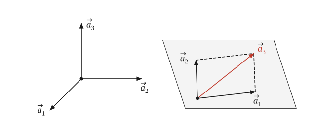
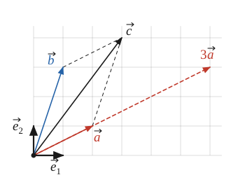
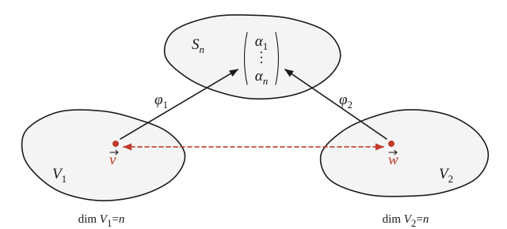

# Лекция 2. Линейные пространства

> **Необходимые знания:** множество, декартово произведение множеств, отображение, действительные числа, геометрические векторы на плоскости и в пространстве, многочлены, однородная система линейных уравнений, индексные функции и суммы из лекции 1.
>
> **О чём лекция:** линейное пространство и его аксиомы, примеры линейных пространств. Линейная зависимость, размерность и базис. Компоненты вектора и изоморфизм линейных пространств.

> **Идея.** Цель курса — тензоры; для них нужно чётко понимать, что такое вектор, а вектор в общем смысле — элемент линейного пространства; это фундамент всего дальнейшего. *(00:09:58–00:10:22)*

Цель курса — тензоры, а для того, чтобы говорить о тензорах, необходимо чётко понимать, что такое векторы. Вектор в общем смысле слова есть элемент линейного пространства, поэтому эта лекция целиком посвящена линейным пространствам. Это фундамент, на котором будет держаться всё дальнейшее изложение.

## 1. Аксиоматический подход

> **Идея.** Пространство — это множество, наделённое структурой; пример — метрическое пространство, где любым двум элементам сопоставлено расстояние, подчинённое аксиомам. *(00:11:21–00:12:20)*

Словом «пространство» в математике называют множество, наделённое некоторой структурой; природа элементов самого множества при этом может быть любой. Например, метрическое пространство — это множество, в котором любым двум элементам сопоставлено число, расстояние между ними. Отображение, задающее расстояние, при этом не произвольно: оно обязано удовлетворять некоторым аксиомам.

> **Идея.** Аксиомы нужны, чтобы с единой точки зрения взглянуть на внешне различные объекты: всё, что доказано из одних аксиом, переносится в любую область, где они выполнены. *(00:12:39–00:14:12)*

Зачем нужны аксиомы, если, например, в геометрии можно работать с обычными расстояниями без всякой аксиоматики? Аксиомы позволяют, как это вообще свойственно математике, взглянуть с единой точки зрения на внешне различные объекты. Аксиомы метрического пространства взялись из геометрии, однако затем оказалось, что расстояние с теми же свойствами можно ввести и в некоторых пространствах функций. Все факты, доказанные исходя из одних только аксиом, автоматически переносятся в любую новую область, где аксиомы выполнены. В этом и состоит ценность аксиоматического подхода: он даёт инструмент, который работает и в известных случаях, и в тех, которые ещё только будут обнаружены.

> **Идея.** Линейное пространство служит той же цели: многочлены и геометрические векторы можно складывать и умножать на числа, оставаясь в том же классе объектов, — значит, эти операции стоит изучать безотносительно к природе объектов. «Многочлен степени не выше второй» вместо «квадратный трёхчлен» — наша поправка, см. Вопрос 2. *(00:14:12–00:15:06)*

Линейное пространство служит ровно этой цели, что видно уже на двух примерах. Если к многочлену степени не выше второй, скажем $x^2 + 2x + 3$, прибавить другой такой же многочлен, снова получится многочлен степени не выше второй; то же произойдёт, если умножить его на число. Если геометрический вектор на плоскости сложить с другим по правилу параллелограмма или растянуть, умножив на число, снова получится вектор. В физике именно так складываются силы, приложенные к телу: их равнодействующая направлена по диагонали параллелограмма. Как видим, операции сложения и умножения на число имеют смысл для объектов совершенно разной природы. Отсюда возникает идея исследовать сами эти операции, безотносительно к тому, к каким объектам они применяются.

> **Вопрос 2.** (00:14:33) В записи: «если взять … квадратный трехчлен … и прибавить к нему другой квадратный трехчлен, то снова получится квадратный трехчлен». Это верно не всегда: старшие члены могут сократиться, что лектор сам показывает в 00:35:26 («степени ровно не подходит»). В тексте — «многочлен степени не выше второй». Варианты: а) оставить так; б) вернуть «квадратный трёхчлен» с оговоркой.

## 2. Определение линейного пространства

> **Идея.** Линейное пространство — это прежде всего множество $V$ с двумя операциями: сложением $V \times V \to V$ и умножением на число $\mathbb{R} \times V \to V$. «Операция», «отображение» вместо «функция» записи — по терминологии его лекции 1 (функция — отображение числовых множеств). *(00:15:06–00:17:01)*

Итак, линейное пространство — это прежде всего множество; обозначим его $V$. Как уже было сказано, пространство есть множество, наделённое структурой. В данном случае структура состоит из двух операций, то есть отображений, определённых на $V$. Первая из них — сложение: она сопоставляет двум элементам $V$ снова элемент $V$, то есть определена на декартовом произведении $V \times V$. Вторая — умножение на число: она сопоставляет действительному числу и элементу $V$ снова элемент $V$:

$$
+\colon V \times V \to V, \qquad \cdot\colon \mathbb{R} \times V \to V.
$$

> **Идея.** Формально значение сложения надо писать $+(\vec a, \vec b)$, но принято писать $\vec a + \vec b$ и $\lambda \vec a$ — как для индексных функций пишут $a_i$ вместо $a(i)$. Второе сравнение из записи, $3 + 5 = 8$ вместо $+(3, 5) = 8$ (00:17:58), опущено: одна аналогия на мысль. *(00:17:01–00:17:58)*

Формально значение сложения на паре $\vec a, \vec b \in V$ следовало бы записывать как $+(\vec a, \vec b)$, по аналогии с записью $f(x, y)$. Однако, так же как для индексных функций в лекции 1 вместо $a(i)$ пишут $a_i$, здесь принята другая запись:

$$
+(\vec a, \vec b) \equiv \vec a + \vec b, \qquad \cdot(\lambda, \vec a) \equiv \lambda \cdot \vec a = \lambda \vec a, \qquad \vec a, \vec b \in V, \quad \lambda \in \mathbb{R}.
$$

> **Идея.** Стрелка над буквой лишь отличает элементы $V$ от чисел и не означает, что вектор геометрический; «линейное» и «векторное» пространство — синонимы. *(00:15:46; 00:17:01–00:17:58)*

Элементы $V$ мы будем обозначать буквами со стрелкой: $\vec a$, $\vec b$. Стрелка не означает, что речь идёт о геометрическом векторе, она лишь отличает элементы абстрактного линейного пространства от чисел. Как уже было сказано, элементы линейного пространства называют векторами, а слова «линейное» и «векторное» пространство — синонимы. Когда понадобится говорить именно о направленных отрезках, мы так и будем говорить: «геометрический вектор».

> **Идея.** Не всякое отображение достойно называться сложением: пока о $+$ ничего не известно, годится даже отображение, дающее для любых двух элементов один и тот же элемент; аксиомы — фильтры, оставляющие только «настоящие» сложение и умножение, а сам значок значения не имеет. *(00:18:51–00:19:47; 00:34:28)*

Однако не всякое отображение мы готовы называть сложением и не всякое — умножением на число. Пока об операциях $+$ и $\cdot$ ничего не известно, на их место годится что угодно. Например, на любом множестве можно определить «сложение», результатом которого для любых двух элементов служит один и тот же, заранее выбранный элемент. Ничему из сказанного выше такое отображение не противоречит, хотя на привычное сложение оно совсем не похоже. Объяснить, что именно мы называем сложением и умножением на число, призваны аксиомы линейного пространства. К ним следует относиться как к фильтрам: из всех отображений указанного вида они оставляют лишь те, которые, по нашему пониманию, достойны этих названий. Сам значок операции при этом никакого значения не имеет, важны только её свойства.

> **Идея.** Первые четыре аксиомы касаются только сложения. *(00:19:47–00:22:33)*

Первые четыре аксиомы касаются только сложения:

1. $\vec a + \vec b = \vec b + \vec a$ для любых $\vec a, \vec b \in V$ (коммутативность);
2. $(\vec a + \vec b) + \vec c = \vec a + (\vec b + \vec c)$ для любых $\vec a, \vec b, \vec c \in V$ (ассоциативность);
3. существует элемент $\vec 0 \in V$ такой, что $\vec a + \vec 0 = \vec a$ для любого $\vec a \in V$;
4. для любого $\vec a \in V$ существует элемент $\vec{\tilde a} \in V$ такой, что $\vec a + \vec{\tilde a} = \vec 0$.

> **Идея.** Запись $\vec a + \vec b + \vec c$ сама по себе бессмыслица, потому что сложение — отображение двух аргументов; ассоциативность делает все расстановки скобок равными, и скобки можно опускать. *(00:20:28–00:21:38)*

Обратим внимание на вторую аксиому. Запись $\vec a + \vec b + \vec c$ в том виде, в каком она написана, — бессмыслица: сложение есть отображение двух аргументов, и складывать сразу три вектора оно не умеет. Осмысленны лишь записи $(\vec a + \vec b) + \vec c$ и $\vec a + (\vec b + \vec c)$, в которых сначала складываются два вектора, а затем к результату, тоже вектору, прибавляется третий. Аксиома ассоциативности утверждает, что оба способа дают одно и то же, как и для обычных чисел. Поэтому скобки можно не писать, и запись $\vec a + \vec b + \vec c$, как и сумма любого числа слагаемых, становится корректной.

> **Идея.** Третья аксиома — существование нейтрального элемента; она исключает «сложение» с единственным значением, поскольку всякий вектор оказывается суммой. Уточнение про пространство из одного элемента — *(добавление)*. *(00:21:38–00:22:33; 00:23:24–00:24:15)*

Третья аксиома утверждает существование нулевого, или нейтрального, элемента; во множестве действительных чисел таким элементом по сложению служит число $0$. В силу первой аксиомы также $\vec 0 + \vec a = \vec a$. Именно третья аксиома исключает «сложение», предложенное выше. Поскольку $\vec a + \vec 0 = \vec a$ для любого $\vec a$, всякий элемент $V$ является результатом некоторого сложения, так что сложение с единственным возможным результатом бывает лишь в пространстве из одного элемента.

> **Идея.** Четвёртая аксиома — существование противоположного элемента; он обозначен $\vec{\tilde a}$, а не $-\vec a$, потому что равенство $\vec{\tilde a} = (-1)\vec a$ ещё нужно доказать. *(00:22:33–00:23:24)*

Четвёртая аксиома требует, чтобы у каждого элемента был противоположный. Его обычно обозначают $-\vec a$, однако такая запись создаёт соблазн считать, что это $(-1) \cdot \vec a$. Это действительно так, но это нужно доказывать, поэтому пока противоположный элемент обозначен $\vec{\tilde a}$.

> **Идея.** Остальные четыре аксиомы касаются умножения на число. *(00:24:15–00:27:16)*

Остальные четыре аксиомы касаются умножения на число. Для любых $\lambda, \mu \in \mathbb{R}$ и любых $\vec a, \vec b \in V$:

5. $(\lambda + \mu)\,\vec a = \lambda \vec a + \mu \vec a$;
6. $\lambda\,(\vec a + \vec b) = \lambda \vec a + \lambda \vec b$;
7. $\lambda\,(\mu \vec a) = (\lambda \mu)\,\vec a$;
8. $1 \cdot \vec a = \vec a$.

> **Идея.** Аксиомы 5 и 6 позволяют раскрывать скобки; в седьмой аксиоме один значок обозначает два разных умножения: числа на вектор и числа на число. Толкование шестой аксиомы («число действует на все векторы одинаково») с примером растяжения опущено: сам лектор назвал его необязательным (00:26:21). *(00:24:15–00:25:17; 00:28:11–00:29:04)*

Аксиомы 5 и 6 разрешают раскрывать скобки, как это привычно для чисел; произвольная операция таким свойством обладать не обязана. В седьмой аксиоме один и тот же значок обозначает две разные операции. Слева вектор дважды умножается на число, а справа сначала перемножаются два числа, и лишь затем на результат умножается вектор. По-хорошему эти операции следовало бы обозначать по-разному. Однако если различие понятно, обозначение может быть любым: по тому, на что действует знак, всегда ясно, о каком умножении идёт речь.

> **Идея.** Следует ли восьмая аксиома из седьмой? Нет: подстановка $\lambda = \mu = 1$ даёт лишь $1 \cdot \vec a = 1 \cdot (1 \cdot \vec a)$; чтобы понять смысл восьмой, нужны требования к набору аксиом: непротиворечивость и неизбыточность. *(00:27:16–00:30:03)*

Следует ли восьмая аксиома из седьмой? Нет. Подставив в седьмую аксиому $\lambda = \mu = 1$, получаем лишь $1 \cdot \vec a = 1 \cdot (1 \cdot \vec a)$, а вовсе не $1 \cdot \vec a = \vec a$. Чтобы понять, зачем нужна восьмая аксиома, скажем несколько слов о наборах аксиом вообще. От всякого набора аксиом требуется прежде всего непротиворечивость: если из аксиом можно вывести противоречие, говорить дальше не о чем. Желательно также, чтобы набор не был избыточен, то есть чтобы ни одна аксиома не следовала из остальных. Избыточность — недостаток менее серьёзный, чем противоречивость, но тоже нежелательный.

> **Идея.** Восьмая аксиома не избыточна: без неё годилось бы вырожденное умножение $\lambda \vec a = \vec 0$, удовлетворяющее всем остальным аксиомам; поэтому её смысл — невырожденность. *(00:30:03–00:31:00)*

Восьмая аксиома как раз не избыточна. Если её отбросить, на роль умножения на число подойдёт отображение

$$
\lambda \vec a = \vec 0 \qquad \text{для всех } \lambda \in \mathbb{R}, \ \vec a \in V,
$$

и все остальные аксиомы будут выполнены. Такой вырожденный случай линейным пространством считать не следует, поэтому приходится требовать $1 \cdot \vec a = \vec a$. Эту аксиому обычно называют аксиомой унитарности, хотя по смыслу ей больше подошло бы название «невырожденность».

> **Идея.** Определение: линейное пространство — множество с операциями сложения и умножения на число, удовлетворяющими аксиомам 1–8. *(00:15:06; 00:19:47)*

Итак, **линейным пространством** называется множество $V$ вместе с операциями сложения и умножения на действительное число, удовлетворяющими аксиомам 1–8.

> **Идея.** Строго говоря, линейное пространство — четвёрка $(V, \mathbb{R}, +, \cdot)$; мы ограничимся вещественными пространствами, по крайней мере на первых порах; множество само по себе линейным пространством не является — вопрос имеет смысл лишь относительно заданных операций. Отступление о полях (00:40:40–00:41:59) сжато до одного придаточного. *(00:40:58–00:41:59; 00:38:10–00:39:02)*

Строго говоря, в определение входят четыре объекта: множество $V$, действительные числа $\mathbb{R}$ и две операции, так что линейное пространство — это четвёрка $(V, \mathbb{R}, +, \cdot)$. Вместо действительных чисел можно взять и другие, например комплексные, но мы, по крайней мере на первых порах, будем заниматься только вещественными линейными пространствами. Следует понимать также, что множество само по себе линейным пространством не является. Вопрос «является ли данное множество линейным пространством?» некорректен; корректен вопрос о том, является ли оно линейным пространством относительно таких-то операций сложения и умножения на число.

> **Идея.** Прежде чем идти дальше, из аксиом нужно вывести простейшие следствия, потому что для любого, даже неизвестного, пространства они не очевидны; пример — единственность нуля от противного. Перенесено сюда из 00:46:38, где оно стоит после определения линейной зависимости, — *(добавление: перестановка)*; обозначение $-\vec a$ после доказательства — тоже наше. *(00:46:38–00:48:38)*

Прежде чем двигаться дальше, необходимо получить из аксиом простейшие следствия. Для геометрических векторов они очевидны. Однако аксиоматика строилась ровно для того, чтобы с единой точки зрения рассматривать любые линейные пространства, в том числе ещё неизвестные, поэтому каждое такое утверждение должно быть выведено из аксиом. Этот шаг легко пропустить, и тогда делаются выводы, которые из аксиом непосредственно не следуют. Понадобятся следующие факты: нулевой элемент единствен, и для любых $\lambda \in \mathbb{R}$ и $\vec a \in V$

$$
0 \cdot \vec a = \vec 0, \qquad \lambda \cdot \vec 0 = \vec 0, \qquad (-1) \cdot \vec a = \vec{\tilde a}.
$$

Все они доказываются непосредственно из аксиом. Для примера докажем единственность нуля; единственность в математике обычно доказывается от противного. Пусть существуют два различных нулевых элемента $\vec 0_1$ и $\vec 0_2$. Поскольку $\vec 0_2$ — нуль, $\vec 0_1 + \vec 0_2 = \vec 0_1$. С другой стороны, $\vec 0_1 + \vec 0_2 = \vec 0_2 + \vec 0_1 = \vec 0_2$, поскольку нулём является и $\vec 0_1$. Следовательно, $\vec 0_1 = \vec 0_2$, что противоречит предположению. Остальные утверждения доказываются в том же духе, хотя и чуть длиннее. В дальнейшем противоположный элемент будем обозначать привычно: $-\vec a$.

> **Идея.** Непротиворечивость аксиом доказывается предъявлением хотя бы одного примера; примерам посвящён следующий раздел. *(00:31:00–00:31:26)*

Как показать, что аксиомы 1–8 непротиворечивы? Достаточно предъявить хотя бы одно множество с операциями, удовлетворяющими всем восьми аксиомам. Таких примеров много, и им посвящён следующий раздел.

## 3. Примеры линейных пространств

### 3.1. Геометрические векторы

> **Идея.** Самый известный пример — геометрические векторы, понимаемые как все направленные отрезки из одной точки, со сложением по правилу параллелограмма и растяжением; аксиомы выполнены, значит, непротиворечивы. *(00:31:26–00:31:50; 00:32:51–00:33:41)*

Самый известный пример линейного пространства — геометрические векторы на плоскости. Под ними следует понимать множество всех направленных отрезков, отложенных из одной точки, со сложением по правилу параллелограмма и умножением на число как растяжением; умножение на отрицательное число к тому же меняет направление вектора на противоположное. Можно убедиться, что все восемь аксиом при этом выполнены; следовательно, аксиомы линейного пространства непротиворечивы. То же верно для геометрических векторов в пространстве.

> **Идея.** В физике векторы откладывают от разных точек, но в линейном пространстве все они отложены из одной точки; вектор, нарисованный в другом месте, — тот же элемент, перенесённый параллельно. Замечание об аффинном пространстве (00:32:16) опущено: только анонс. *(00:31:38–00:32:51)*

В физике к этому относятся несколько вольно и откладывают векторы от разных точек. Следует понимать, что в линейном пространстве геометрических векторов все векторы отложены из одной точки: вектор, нарисованный в другом месте, — это тот же элемент пространства, перенесённый параллельно.

> **Идея.** Предупреждение: у геометрических векторов есть длина и угол, а у линейного пространства как такового их нет; о длине многочлена или угле между многочленами говорить бессмысленно. Перенесено из 00:56:53 к примеру, о котором идёт речь, и сокращено (коллинеарность, евклидова структура опущены). *(00:56:53–00:57:47)*

Предупреждение: геометрические векторы, с помощью которых линейные пространства удобно себе представлять, обладают более богатой структурой, а именно для них определены длина и угол. В линейном пространстве как таковом этих понятий нет. Поэтому, представляя себе, например, многочлены стрелками, следует помнить, что говорить о длине многочлена или об угле между многочленами бессмысленно.

### 3.2. Многочлены

> **Идея.** Многочлены, в том числе степени не выше $n$, образуют линейное пространство, а многочлены степени ровно $n$ — нет: сумма может иметь меньшую степень. Обозначение $P_n$ (00:56:01) не вводится: в лекции не используется. *(00:34:34–00:36:25)*

Многочлены от $x$ со сложением многочленов и умножением многочлена на число образуют линейное пространство: сумма двух многочленов и произведение многочлена на число — снова многочлены, и все восемь аксиом выполнены. То же верно для многочленов степени не выше $n$, где $n \in \mathbb{N}$ фиксировано; это хрестоматийный пример. А вот многочлены степени ровно $n$ линейного пространства не образуют, поскольку сумма двух таких многочленов может иметь меньшую степень. Например, при $n = 2$

$$
(x^2 + 2x + 1) + (-x^2 + 2x + 1) = 4x + 2.
$$

### 3.3. Столбцы

> **Идея.** Самый важный пример — столбцы высоты $n$ с покомпонентными операциями, пространство $S_n$; это индексные функции из лекции 1 с их сложением (связь с лекцией 1 — *(добавление)*). Почему пример важнейший, выяснится в конце лекции. *(00:35:26–00:37:18; 00:55:56)*

Самый важный пример — столбцы из $n$ действительных чисел. Сложение двух столбцов и умножение столбца на число определяются покомпонентно:

$$
\begin{pmatrix} a_1 \\ \vdots \\ a_n \end{pmatrix} + \begin{pmatrix} b_1 \\ \vdots \\ b_n \end{pmatrix} = \begin{pmatrix} a_1 + b_1 \\ \vdots \\ a_n + b_n \end{pmatrix}, \qquad \lambda \begin{pmatrix} a_1 \\ \vdots \\ a_n \end{pmatrix} = \begin{pmatrix} \lambda a_1 \\ \vdots \\ \lambda a_n \end{pmatrix}.
$$

Столбец высоты $n$ — не что иное, как индексная функция $a\colon I \to \mathbb{R}$ из лекции 1, записанная столбцом. Сложение столбцов — уже знакомое $(a + b)_i = a_i + b_i$, а умножение на число определяется так же: $(\lambda a)_i = \lambda a_i$. Получающееся линейное пространство мы будем обозначать $S_n$. Почему этот пример важнее остальных, выяснится в конце лекции.

### 3.4. Векторы в физике

> **Идея.** Почему одни физические величины — векторы, а другие нет? Вектором величину делает не стрелка, а то, что такие величины складываются: ток — скаляр, хотя его рисуют стрелкой, а скорости, силы и поля складываются и потому векторы; квантовая механика тоже опирается на структуру линейного пространства. Рассказ о Минакове (01:35:42–01:37:17) опущен: цитата из книги, вторая иллюстрация той же мысли. Перенесено из конца лекции в примеры. *(01:34:39–01:35:42; 01:37:50–01:38:41; 00:37:18–00:38:10)*

Почему одни физические величины — векторы, а другие нет? Ток в электрической цепи изображают стрелкой вдоль провода, однако ток — скаляр. Скорость тоже изображают стрелкой, но она вектор. Разница в том, что скорости складываются: существует закон сложения скоростей, и складываются они именно как векторы. Так же складываются силы, когда находят равнодействующую, и электрические и магнитные поля по принципу суперпозиции. Для токов же векторное сложение смысла не имеет: направление тока задано проводом. Вектором величину делает не стрелка, а то, что она является элементом линейного пространства, то есть умеет складываться с себе подобными и умножаться на число. Изображать её стрелкой при этом не обязательно. Если квантовая система может находиться в одном состоянии и в другом, она может находиться и в их сумме, поэтому квантовая механика естественным образом опирается на структуру линейного пространства.

## 4. Линейная зависимость

> **Идея.** Что можно делать в линейном пространстве? Только складывать и умножать на числа, поэтому самая общая конструкция — конечная линейная комбинация. Отступление о топологии (00:42:35) сжато до придаточного. *(00:39:02–00:40:17; 00:41:59–00:42:55)*

Что вообще можно делать в линейном пространстве? Лишь две вещи: складывать векторы и умножать их на числа. Умножив несколько векторов на числа и сложив результаты, мы снова получим вектор. Поэтому самая общая конструкция, которую можно построить в линейном пространстве, — это выражение

$$
\alpha_1 \vec a_1 + \alpha_2 \vec a_2 + \dots + \alpha_k \vec a_k, \qquad \alpha_i \in \mathbb{R}, \quad \vec a_i \in V,
$$

которое называется линейной комбинацией векторов $\vec a_1, \dots, \vec a_k$, а числа $\alpha_i$ — её коэффициентами. Линейная комбинация всегда конечна, поскольку бесконечная сумма есть предел, а для предела в линейном пространстве нет необходимой структуры.

> **Идея.** Три попарно перпендикулярных вектора и три вектора в одной плоскости различаются: во втором наборе один вектор выражается через два других; на этом различии строится размерность. *(00:42:55–00:43:48)*

Что можно сказать о наборе векторов $\vec a_1, \dots, \vec a_k$? Рассмотрим два набора из трёх геометрических векторов в пространстве: три попарно перпендикулярных вектора и три вектора, лежащих в одной плоскости (рис. 1). Интуитивно ясно, что между этими наборами есть разница. Она состоит в том, что в первом наборе ни один вектор не выражается в виде линейной комбинации двух других, а во втором такой вектор есть, например $\vec a_3 = \vec a_1 + \vec a_2$. Как мы увидим, именно на этом различии строится, пожалуй, единственная характеристика линейного пространства — его размерность.

*Рис. 1. Два набора из трёх геометрических векторов.*

> **Идея.** Набор линейно зависим, если хотя бы один вектор выражается через остальные, и линейно независим, если ни один не выражается; это берём за определение, равносильное условие будет получено ниже. *(00:43:48–00:45:37)*

Набор (говорят также: система) векторов $\vec a_1, \dots, \vec a_k$ из $V$ называется линейно зависимым, если хотя бы один из векторов выражается в виде линейной комбинации остальных. Отрицание этого утверждения строится по формальным правилам: набор называется линейно независимым, если ни один из векторов не выражается в виде линейной комбинации остальных. Будем считать это определением. Часто в качестве определения используют другое, равносильное условие, технически более удобное; оно будет получено ниже.

> **Идея.** Нулевой вектор всегда раскладывается по набору тривиально; нетривиально — тогда и только тогда, когда набор зависим. *(00:45:37–00:46:38; 00:49:20–00:49:47)*

Попробуем разложить по набору $\vec a_1, \dots, \vec a_k$ нулевой вектор, то есть подобрать коэффициенты так, чтобы

$$
\alpha_1 \vec a_1 + \alpha_2 \vec a_2 + \dots + \alpha_k \vec a_k = \vec 0.
$$

Если все коэффициенты равны нулю, равенство выполнено при любом наборе, поскольку $0 \cdot \vec a = \vec 0$. Такая линейная комбинация называется тривиальной. Можно ли разложить нулевой вектор нетривиально, то есть так, чтобы не все коэффициенты были нулями? Можно, если и только если набор линейно зависим.

> **Идея.** Доказательство критерия: перенос слагаемого (прибавление противоположного) и деление на ненулевой коэффициент, и обратно; оба условия годятся как определение. *(00:49:47–00:51:05)*

Доказательство просто и опирается лишь на аксиомы. Пусть в нетривиальной комбинации, равной нулю, коэффициент $\alpha_1 \neq 0$ (какой именно вектор стоит первым, не принципиально). Прибавим к обеим частям равенства вектор, противоположный $\alpha_1 \vec a_1$, и умножим результат на $-1/\alpha_1$. Получим

$$
\vec a_1 = -\frac{\alpha_2}{\alpha_1}\,\vec a_2 - \dots - \frac{\alpha_k}{\alpha_1}\,\vec a_k,
$$

то есть $\vec a_1$ выражается через остальные. Обратно, если, например, $\vec a_1 = \beta_2 \vec a_2 + \dots + \beta_k \vec a_k$, то

$$
(-1)\,\vec a_1 + \beta_2 \vec a_2 + \dots + \beta_k \vec a_k = \vec 0,
$$

и эта комбинация нетривиальна, поскольку коэффициент при $\vec a_1$ равен $-1$. Следовательно, набор линейно независим тогда и только тогда, когда нулевой вектор раскладывается по нему лишь тривиально. Любое из этих двух условий можно считать определением, а другое — критерием.

> **Идея.** При добавлении вектора зависимый набор остаётся зависимым, а независимый может стать зависимым (если добавить $\vec 0$) или остаться независимым; но бесконечно добавлять векторы, сохраняя независимость, может не получиться. *(00:51:05–00:53:57)*

Что произойдёт с набором, если добавить к нему ещё один вектор? Линейно зависимый набор останется линейно зависимым при добавлении любого вектора: в нетривиальной комбинации, равной нулю, достаточно поставить при новом векторе коэффициент $0$. С линейно независимым набором возможны оба исхода. Если добавить нулевой вектор, набор заведомо станет зависимым: при $\vec 0$ можно поставить коэффициент $1$, а при остальных векторах — нули. Если же к одному вектору на плоскости добавить вектор, ему не пропорциональный, набор останется независимым. Однако добавлять векторы бесконечно, сохраняя независимость, может и не получиться. Среди геометрических векторов в пространстве, взяв три линейно независимых, четвёртый добавить уже нельзя: любой вектор выражается через эти три.

## 5. Размерность и базис

> **Идея.** Размерность — наибольшее число векторов в линейно независимом наборе; плоскость даёт двумерное пространство, пространство — трёхмерное. *(00:53:57–00:54:59)*

Сказанное приводит к понятию размерности. Наибольшее возможное число векторов в линейно независимом наборе характеризует само пространство; оно называется размерностью линейного пространства $V$ и обозначается $\dim V$. Так, геометрические векторы на плоскости образуют двумерное линейное пространство, а геометрические векторы в пространстве — трёхмерное.

> **Идея.** Какова размерность $S_4$? Четыре столбца с одной единицей линейно независимы, и любой столбец через них выражается; что пяти независимых столбцов нет вовсе, следует из леммы ниже (это уточнение — *(добавление)*). *(00:54:59–00:56:01)*

Какова размерность пространства $S_4$? Столбцы

$$
\begin{pmatrix} 1 \\ 0 \\ 0 \\ 0 \end{pmatrix}, \quad \begin{pmatrix} 0 \\ 1 \\ 0 \\ 0 \end{pmatrix}, \quad \begin{pmatrix} 0 \\ 0 \\ 1 \\ 0 \end{pmatrix}, \quad \begin{pmatrix} 0 \\ 0 \\ 0 \\ 1 \end{pmatrix}
$$

линейно независимы: их линейная комбинация с коэффициентами $\alpha_1, \dots, \alpha_4$ есть столбец из чисел $\alpha_1, \dots, \alpha_4$, и он равен нулевому столбцу, то есть нулю пространства $S_4$, только при $\alpha_1 = \dots = \alpha_4 = 0$. Любой столбец выражается через эти четыре, причём коэффициентами служат его собственные элементы, так что пятый столбец добавить к ним, сохранив независимость, нельзя. Что пяти линейно независимых столбцов в $S_4$ нет вовсе, будет доказано ниже; тогда $\dim S_4 = 4$.

> **Идея.** Если независимый набор после добавления вектора $\vec a$ стал зависимым, то через остальные выражается именно $\vec a$: иначе коэффициент при $\vec a$ равен нулю и независимость нарушена. Мотивировка («набор, который нельзя дополнить») поставлена перед утверждением. *(00:58:27–01:03:23)*

Пусть линейно независимый набор нельзя дополнить ни одним вектором так, чтобы он остался независимым. Естественно ожидать, что тогда через него выражается любой вектор. Это следует из такого утверждения. Пусть векторы $\vec e_1, \dots, \vec e_k$ линейно независимы, а после добавления к ним вектора $\vec a$ набор стал линейно зависимым. Тогда через остальные выражается именно $\vec a$. Это не очевидно: из зависимости набора следует лишь, что какой-то из его векторов выражается через остальные, и заранее неясно, какой. Составим нетривиальную линейную комбинацию, равную нулю:

$$
\alpha_1 \vec e_1 + \dots + \alpha_k \vec e_k + \alpha \vec a = \vec 0.
$$

Пусть, от противного, $\alpha = 0$. Тогда остаётся нетривиальная комбинация векторов $\vec e_1, \dots, \vec e_k$, равная нулю, а это противоречит их линейной независимости. Следовательно, $\alpha \neq 0$, и, как было показано выше, вектор $\vec a$ выражается через $\vec e_1, \dots, \vec e_k$. Остальные коэффициенты при этом тоже могут быть ненулевыми, так что через другие векторы может выражаться и какой-то из $\vec e_i$; но $\vec a$ выражается заведомо.

> **Идея.** Значит, через $n$ линейно независимых векторов $n$-мерного пространства выражается любой вектор; на этом основано понятие базиса: упорядоченный линейно независимый набор, через который выражается любой элемент. *(01:03:23–01:04:32; 01:05:25)*

В $n$-мерном пространстве любой набор из $n + 1$ векторов линейно зависим. Поэтому, как было выяснено, через $n$ линейно независимых векторов такого пространства выражается любой вектор. На этом основано понятие базиса. Базисом линейного пространства $V$ называется упорядоченный линейно независимый набор векторов, через линейные комбинации которого выражается любой элемент $V$.

> **Идея.** Требования неравноценны: главное — выражаемость любого вектора; независимость убирает лишнюю информацию и даёт единственность разложения; упорядоченность нужна, чтобы задавать вектор набором чисел. *(01:04:32–01:06:31)*

В этом определении три требования, и они неравноценны. Главное — чтобы через набор выражался любой вектор. Линейная независимость нужна для того, чтобы в наборе не было лишней информации: как будет показано ниже, если вектор раскладывается по линейно независимому набору, то единственным образом. Наконец, упорядоченность нужна для того, чтобы вектор можно было однозначно задавать набором коэффициентов, забыв о самих базисных векторах. Например,

$$
\vec e_1 + 2\vec e_2 + 3\vec e_3 \neq \vec e_1 + 3\vec e_2 + 2\vec e_3,
$$

хотя коэффициенты в обоих случаях — одни и те же числа $1, 2, 3$. Поэтому базис — не просто множество векторов, а упорядоченный набор.

> **Идея.** Основная лемма о линейной зависимости: если каждый из $m$ векторов выражается через $n < m$ векторов, то эти $m$ векторов линейно зависимы; информации в большем наборе не больше, чем в меньшем. *(01:06:31–01:08:28)*

Естественно ожидать, что в каждом базисе $n$-мерного пространства ровно $n$ векторов. Ключевую роль в доказательстве этого играет так называемая основная лемма о линейной зависимости. Пусть даны два набора векторов из $V$: $\vec e_1, \dots, \vec e_n$ и $\vec g_1, \dots, \vec g_m$, причём $m > n$, и каждый вектор второго набора выражается через векторы первого. Тогда второй набор линейно зависим. Неформально говоря, если каждый вектор большего набора выражается через меньший, то информации в нём не может быть больше, чем в меньшем. Например, любые четыре геометрических вектора в трёхмерном пространстве выражаются через три базисных и потому линейно зависимы. О линейной независимости первого набора в лемме ничего не предполагается.

> **Идея.** Разложения $\vec g_i$ по $\vec e_j$ записываются одной формулой с двухиндексной функцией $\alpha\colon I_2 \times I_1 \to \mathbb{R}$. Замечание о векторах с индексом как отображениях $I_1 \to V$ (01:09:31–01:10:23) опущено: сам лектор назвал его формальностью, дальше оно не используется. *(01:08:28–01:09:31)*

Доказательство — хорошее упражнение в индексной записи. Разложения векторов $\vec g_i$ по векторам $\vec e_j$ записываются одной формулой:

$$
\vec g_i = \sum_{j=1}^{n} \alpha_{ij}\, \vec e_j, \qquad i \in I_2 = \{1, \ldots, m\}, \quad j \in I_1 = \{1, \ldots, n\}.
$$

Здесь $\alpha$ — обычная двухиндексная функция $\alpha\colon I_2 \times I_1 \to \mathbb{R}$ в смысле лекции 1.

> **Идея.** Подставив разложения в $\sum \beta_i \vec g_i = \vec 0$ и сгруппировав слагаемые при $\vec e_j$, получаем достаточное условие: $\sum_i \beta_i \alpha_{ij} = 0$ для каждого $j$; если ему удовлетворяют не все нулевые $\beta$, второй набор зависим. Ссылки на аксиомы при группировке — *(добавление)*. *(01:10:23–01:14:26)*

Составим линейную комбинацию векторов второго набора и потребуем, чтобы она равнялась нулю:

$$
\sum_{i=1}^{m} \beta_i\, \vec g_i = \vec 0.
$$

Подставим сюда разложения, раскроем скобки (аксиомы 6 и 7) и сгруппируем слагаемые при каждом $\vec e_j$ (аксиомы 1, 2 и 5; по существу это перестановочность сумм из лекции 1):

$$
\sum_{i=1}^{m} \beta_i \sum_{j=1}^{n} \alpha_{ij}\, \vec e_j = \sum_{j=1}^{n} \Bigl( \sum_{i=1}^{m} \beta_i\, \alpha_{ij} \Bigr) \vec e_j = \vec 0.
$$

Равенство заведомо выполнено, если все коэффициенты при $\vec e_j$ равны нулю:

$$
\sum_{i=1}^{m} \beta_i\, \alpha_{ij} = 0, \qquad j = 1, \ldots, n.
$$

Остаётся показать, что этим равенствам удовлетворяют какие-то $\beta_i$, не все равные нулю. Тогда $\sum_i \beta_i \vec g_i = \vec 0$ — нетривиальная комбинация, и второй набор линейно зависим.

> **Идея.** Это однородная система из $n$ уравнений с $m$ неизвестными; в матричной записи строки нумерует второй индекс $\alpha$, а не первый. *(01:15:19–01:16:58)*

Получилась однородная система из $n$ линейных уравнений с $m$ неизвестными $\beta_1, \dots, \beta_m$. В матричной записи

$$
\begin{pmatrix} \alpha_{11} & \alpha_{21} & \cdots & \alpha_{m1} \\ \alpha_{12} & \alpha_{22} & \cdots & \alpha_{m2} \\ \vdots & \vdots & & \vdots \\ \alpha_{1n} & \alpha_{2n} & \cdots & \alpha_{mn} \end{pmatrix} \begin{pmatrix} \beta_1 \\ \beta_2 \\ \vdots \\ \beta_m \end{pmatrix} = \begin{pmatrix} 0 \\ 0 \\ \vdots \\ 0 \end{pmatrix}.
$$

Заметим, что строки здесь нумерует второй индекс $\alpha$, а не первый, как принято для матриц, поскольку суммирование идёт по первому.

> **Идея.** Неизвестных больше, чем уравнений, поэтому есть ненулевое решение: пример $x + y = 0$; в общем случае метод Гаусса выражает не более $n$ главных неизвестных через свободные, которых не меньше одной. Решение $x = 1$, $y = -1$ — *(добавление)*. *(01:16:58–01:18:49)*

Поскольку $m > n$, неизвестных больше, чем уравнений, и такая система всегда имеет ненулевое решение. Простейший пример — одно уравнение с двумя неизвестными $x + y = 0$, у которого есть решение $x = 1$, $y = -1$. В общем случае это показывает метод Гаусса, то есть последовательное исключение неизвестных. В результате не более $n$ неизвестных, «главных», выражаются через остальные, «свободные», которых не меньше $m - n \geq 1$. Придав свободным неизвестным значения, не все равные нулю, получим ненулевое решение, что и завершает доказательство леммы.

> **Идея.** Следствие леммы: во всех базисах одно и то же число векторов, равное размерности, и базис существует; в частности, $\dim S_4 = 4$ (это уточнение — *(добавление)*); бесконечномерными пространствами не занимаемся. *(01:18:49–01:21:05)*

Из леммы следует, что во всех базисах пространства одно и то же число векторов. Действительно, пусть есть два базиса и в первом векторов меньше, чем во втором. Каждый вектор второго базиса выражается через первый, поэтому по лемме второй базис линейно зависим и базисом не является. Это число равно размерности пространства. Больше $n$ векторов в базисе $n$-мерного пространства быть не может, поскольку базис линейно независим. Меньше тоже не может: иначе $n$ линейно независимых векторов, существующих по определению размерности, выражались бы через меньший набор и по лемме были бы зависимы. Базис при этом существует: как было показано, любой линейно независимый набор из $n$ векторов является базисом. Наконец, любые пять столбцов из $S_4$ выражаются через четыре столбца, указанных выше, и по лемме линейно зависимы; тем самым $\dim S_4 = 4$. Бывает и так, что линейно независимые векторы можно добавлять бесконечно. Такие пространства называются бесконечномерными, и ими мы заниматься не будем: всюду далее $\dim V = n \in \mathbb{N}$.

> **Идея.** Разложение по базису единственно (от противного: разность двух разложений — комбинация, равная нулю, и все её коэффициенты нули); по зависимому набору оно не единственно. *(01:05:30; 01:21:05)*

Разложение вектора по базису единственно. Как всегда, единственность доказывается от противного. Пусть вектор $\vec a$ имеет два различных разложения, $\vec a = \sum_i \alpha_i \vec e_i = \sum_i \alpha'_i \vec e_i$. Прибавив к первому разложению вектор, противоположный второму, получим $\sum_i (\alpha_i - \alpha'_i)\, \vec e_i = \vec 0$. В силу линейной независимости базиса все разности $\alpha_i - \alpha'_i$ равны нулю, то есть разложения совпадают, что противоречит предположению. По линейно зависимому набору разложение, напротив, не единственно: к любому разложению можно прибавить нетривиальную комбинацию, равную нулю.

## 6. Компоненты вектора. Изоморфизм

> **Идея.** Коэффициенты разложения по базису называются компонентами; радиус-вектор $x\vec i + y\vec j + z\vec k$ из механики — пример. *(01:21:32–01:22:26)*

Пусть в линейном пространстве $V$, $\dim V = n$, выбран базис $\vec e_1, \dots, \vec e_n$. Каждый вектор единственным образом раскладывается по нему:

$$
\vec a = \sum_{i=1}^{n} \alpha_i\, \vec e_i.
$$

Числа $\alpha_1, \dots, \alpha_n$ называются компонентами вектора $\vec a$ в базисе $\vec e_1, \dots, \vec e_n$. Знакомый пример — радиус-вектор точки в механике, $\vec r = x\,\vec i + y\,\vec j + z\,\vec k$: это в точности разложение по базису $\vec i, \vec j, \vec k$, а числа $x, y, z$ — компоненты.

> **Идея.** Компоненты не следует путать с координатами: координаты параметризуют точки множества и появятся при изучении многообразий; совпадают они с компонентами лишь для радиус-вектора; мы говорим только «компоненты». *(01:24:33–01:26:21)*

Компоненты вектора часто называют его координатами, однако координаты — совсем другое понятие. Координаты — это числа, которыми параметризуются точки некоторого множества, например два угла на поверхности Земли; речь о них пойдёт значительно позже, при изучении многообразий. Совпадают координаты и компоненты лишь в одном случае: когда на плоскости или в пространстве выбран базис и компоненты радиус-вектора точки служат по совместительству её координатами, как числа $x, y, z$ выше. Чтобы нигде не возникло путаницы, мы будем говорить только «компоненты», и для векторов, и в дальнейшем для тензоров.

> **Идея.** Пример на плоскости: столбец компонент суммы равен сумме столбцов, а столбец $3\vec a$ — утроенному столбцу $\vec a$; можно сначала сложить векторы, а можно сначала сложить компоненты. *(01:22:26–01:24:33; 01:26:21–01:29:08)*

Рассмотрим пример: пусть на плоскости выбран базис $\vec e_1, \vec e_2$ и

$$
\vec a = 2\vec e_1 + \vec e_2, \qquad \vec b = \vec e_1 + 3\vec e_2.
$$

Сложив векторы по правилу параллелограмма, получим $\vec c = \vec a + \vec b = 3\vec e_1 + 4\vec e_2$, а растянув $\vec a$ втрое, получим $3\vec a = 6\vec e_1 + 3\vec e_2$ (рис. 2). Сопоставим каждому вектору столбец его компонент:

$$
\vec a \mapsto \begin{pmatrix} 2 \\ 1 \end{pmatrix}, \qquad \vec b \mapsto \begin{pmatrix} 1 \\ 3 \end{pmatrix}, \qquad \vec c \mapsto \begin{pmatrix} 3 \\ 4 \end{pmatrix}, \qquad 3\vec a \mapsto \begin{pmatrix} 6 \\ 3 \end{pmatrix}.
$$

Столбец вектора $\vec c = \vec a + \vec b$ оказывается суммой столбцов векторов $\vec a$ и $\vec b$, а столбец вектора $3\vec a$ — столбцом вектора $\vec a$, умноженным на $3$. Можно сначала сложить векторы и затем найти компоненты, а можно сначала найти компоненты и сложить их как столбцы: результат один и тот же.

*Рис. 2. Векторы $\vec a$, $\vec b$, их сумма $\vec c$ и вектор $3\vec a$; сетка проведена вдоль векторов базиса.*

> **Идея.** Выбор базиса задаёт отображение $\varphi\colon V \to S_2$, переводящее сумму в сумму и произведение на число в произведение; это верно в любом базисе любого пространства (общий вывод из аксиом — *(добавление)*); столбец — сам элемент $S_2$, базис в $S_2$ не нужен. *(01:27:15–01:29:08; 01:39:33–01:41:22)*

Обозначим через $V$ пространство геометрических векторов на плоскости. Выбор базиса задаёт отображение $\varphi\colon V \to S_2$, сопоставляющее каждому вектору столбец его компонент; другой базис дал бы другое отображение. Найденное свойство записывается так:

$$
\varphi(\vec a + \vec b) = \varphi(\vec a) + \varphi(\vec b), \qquad \varphi(3\vec a) = 3\,\varphi(\vec a).
$$

Это верно не только в данном примере. Если $\vec a = \sum_i \alpha_i \vec e_i$ и $\vec b = \sum_i \beta_i \vec e_i$, то по аксиомам 1, 2 и 5 для суммы и по аксиомам 6 и 7 для произведения

$$
\vec a + \vec b = \sum_{i=1}^{n} (\alpha_i + \beta_i)\, \vec e_i, \qquad \lambda \vec a = \sum_{i=1}^{n} (\lambda \alpha_i)\, \vec e_i,
$$

то есть компоненты суммы суть суммы компонент, а компоненты произведения на число — компоненты, умноженные на это число. Следует понимать, что столбец компонент — сам элемент пространства $S_2$, а не разложение по какому-то базису в $S_2$: никакого базиса в $S_2$ для этого выбирать не нужно.

> **Идея.** Операции с векторами можно проделывать со столбцами: пространства устроены одинаково; изоморфизм — взаимно однозначное отображение, сохраняющее сложение и умножение на число; отображение, задаваемое базисом, — изоморфизм. «Взаимно однозначное» и обоснование для $\varphi$ — *(добавление)*, см. Вопрос 1. Замечание «нуль переходит в нуль» (01:31:30) опущено: дальше не используется. *(01:29:08–01:31:55)*

Таким образом, все операции с геометрическими векторами можно проделывать с соответствующими столбцами, и результат будет тем же: пространство геометрических векторов на плоскости устроено точно так же, как пространство столбцов $S_2$. Это и называется изоморфизмом, что буквально означает «одинаковое устройство». Линейные пространства $V_1$ и $V_2$ называются изоморфными, если существует взаимно однозначное отображение $\varphi\colon V_1 \to V_2$, сохраняющее их структуру, то есть сложение и умножение на число:

$$
\varphi(\vec a + \vec b) = \varphi(\vec a) + \varphi(\vec b), \qquad \varphi(\lambda \vec a) = \lambda\, \varphi(\vec a) \qquad \forall\, \vec a, \vec b \in V_1, \quad \forall\, \lambda \in \mathbb{R}.
$$

Само отображение $\varphi$ называется изоморфизмом. Отображение, задаваемое базисом, взаимно однозначно, поскольку каждому вектору отвечает ровно один столбец, а каждый столбец есть столбец компонент ровно одного вектора; значит, это изоморфизм.

> **Вопрос 1.** (01:30:59) В записи и в заметках (с. 6) изоморфизм определён только двумя равенствами: $\varphi(\vec a + \vec b) = \varphi(\vec a) + \varphi(\vec b)$ и $\varphi(\alpha \vec a) = \alpha\,\varphi(\vec a)$. Без взаимной однозначности под это определение подходит, например, отображение всех векторов в нуль, а пространства разной размерности оказываются «изоморфными». В тексте добавлено «взаимно однозначное» и проверка этого свойства в доказательстве теоремы ниже. Варианты: а) оставить так; б) вернуть определение из записи, а взаимную однозначность оговорить отдельно.

> **Идея.** Все линейные пространства одной размерности изоморфны: базисы задают изоморфизмы с $S_n$, и векторы с одинаковыми столбцами сопоставляются друг другу; изоморфизмов много; пространства разной размерности не изоморфны. Проверка взаимной однозначности — *(добавление)*; «столько же изоморфизмов, сколько базисов» из записи уточнено: разные пары базисов могут дать один изоморфизм. *(01:31:55–01:33:48)*

Все линейные пространства одной размерности изоморфны. Пусть $\dim V_1 = \dim V_2 = n$. Выбор базиса в $V_1$ задаёт изоморфизм $\varphi_1\colon V_1 \to S_n$, выбор базиса в $V_2$ — изоморфизм $\varphi_2\colon V_2 \to S_n$. Сопоставим каждому вектору $\vec v \in V_1$ вектор $\vec w \in V_2$ с тем же столбцом компонент (рис. 3). Это отображение взаимно однозначно, поскольку взаимно однозначны $\varphi_1$ и $\varphi_2$; сумма при этом переходит в сумму, а произведение на число — в произведение на то же число. Следовательно, получается изоморфизм пространств $V_1$ и $V_2$. Таких изоморфизмов много: каждая пара базисов задаёт некоторый изоморфизм. Пространства разной размерности, напротив, изоморфными быть не могут.

*Рис. 3. Базисы в $V_1$ и $V_2$ задают изоморфизмы $\varphi_1$, $\varphi_2$ с $S_n$; векторы $\vec v$ и $\vec w$ с одним и тем же столбцом компонент сопоставляются друг другу.*

> **Идея.** Зачем нужны изоморфизмы? Любое $n$-мерное пространство выбором базиса сводится к $S_n$, и природу элементов можно забыть; отсюда взгляд на линейную алгебру как на науку о столбцах, и отсюда же размерность — единственная характеристика линейного пространства. Замечание о тензорах как наборах изоморфизмов (01:34:17) опущено: дальше в лекции не используется. *(01:33:25–01:34:39; 00:36:25–00:37:18; 00:56:01)*

Зачем нужны изоморфизмы? Любое $n$-мерное линейное пространство выбором базиса сводится к $S_n$. Выбрав базис, можно забыть, что именно было элементами пространства, многочлены, геометрические векторы или что-то ещё, и работать со столбцами компонент. Именно поэтому линейную алгебру часто воспринимают как науку о столбцах. По той же причине у линейного пространства как такового есть лишь одна характеристика, отличающая его от других, — размерность.

---

*Конец лекции 2.*
